# User manual — STAGESPACE

A **spatial trajectory and position engine**: STAGESPACE produces no
sound — it sends the positions, channels and modulations of your audio
objects over OSC to an external renderer (Holophonix, SPAT Revolution,
IEM, ADM-OSC, or any OSC receiver).

```
Node graph → f(t) engines → 60fps merge → OSC → renderer → speakers
```

---

## 1. Getting started

### Welcome

On first launch, STAGESPACE offers to load the **example show** or to
start from scratch. The show lexicon is displayed right away — remember
these 4 words:

| Term | Meaning |
|-----|---------------|
| **Template** | a trajectory shape (Circle, Spiral, Physics…) |
| **Move** | a template + assigned tracks + parameters |
| **Setlist** | your ordered moves — GO advances through it |
| **Cue** | a snapshot you recall live (Shift+Enter) |

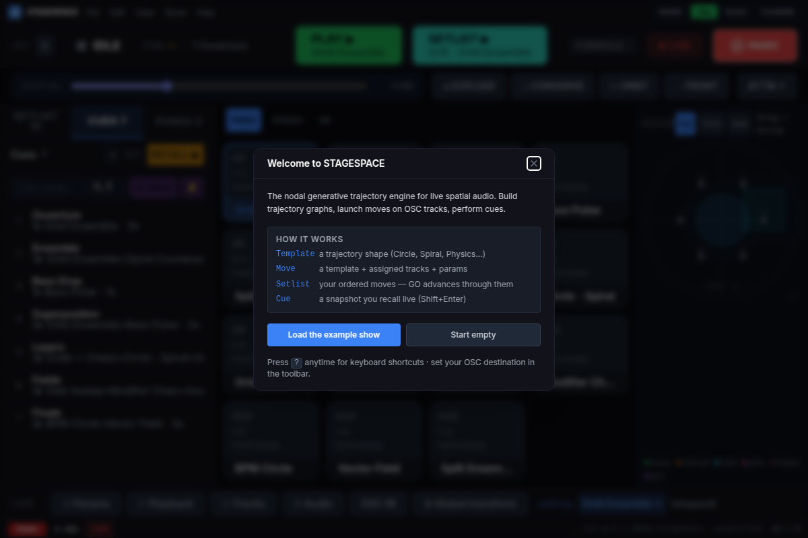

### Minimal setup

1. Import your **`.hol`** project (*File → Import Holophonix project…*) to
   populate the tracks — or define **manual OSC ids** in Settings.
2. Configure **OSC out**: address, port, renderer profile
   (Holophonix / Spat / IEM / ADM / generic XYZ / generic AED) —
   *Edit → Preferences…*, or click the OSC destination in the StatusBar.
3. Positions stream at **60 fps** as soon as a move is playing.

---

## 2. The surfaces

STAGESPACE is organized around **four first-class surfaces**, switched
from the titlebar nav, the *View* menu, or `/stagespace/view` from a
console: **Atelier** (composer — graphs, moves, cues, settings),
**Jeu** (perform live — pads, gestures, radar), **Score** (timeline
sequencer) and **Conduite** (run the show — cues, GO, monitoring).
The Jeu and Conduite surfaces can each be **detached** into a dedicated
window (⧉) for a second screen.

### 2.1 Jeu — the live surface

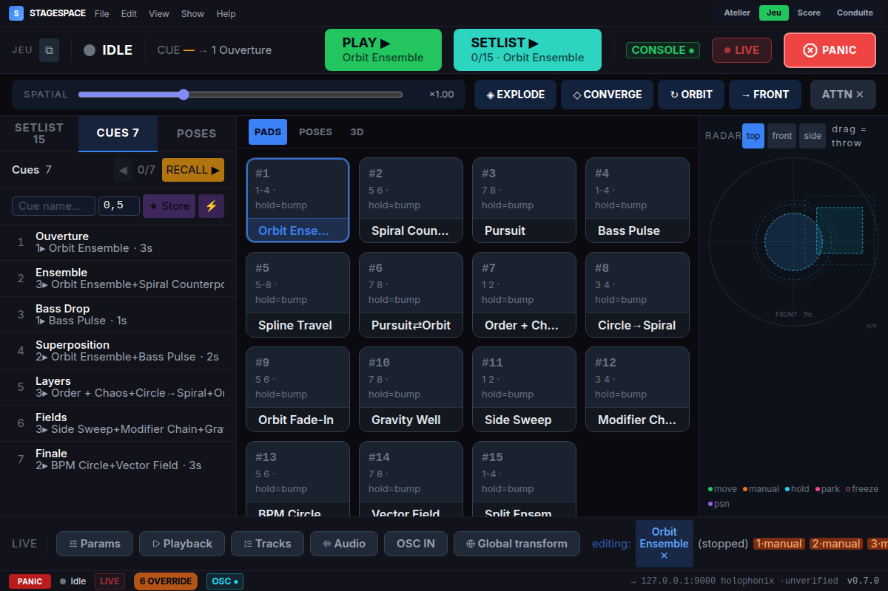

| Zone | Role |
|------|------|
| Topbar | LIVE count/IDLE · cue context · **PLAY ▶/STOP ■** (armed slot) · **SETLIST ▶** (GO) · TC · CONSOLE ● · **LIVE/DRY-RUN** · **PANIC** · ⧉ detach |
| Gesture strip | **spatial k** compressor slider · EXPLODE/CONVERGE/ORBIT/FRONT gesture buttons · ATTN ✕ release · UNSOLO · STOP ALL |
| Left column | tabs **SETLIST** (GO advances here) / **CUES** / **POSES** — layers (parallel) listed under the setlist |
| Center | tabs **Pads** (busking wall, default) / **Poses** (pose-pads) / **3D** — the 3D preview stays mounted in the background |
| Right | 2D radar — live positions colored by control source, **top/front/side** view selector, drag = grab & throw |
| Bottom drawer | scoped panels: Params · Playback · Tracks · Audio · OSC IN · Global transform |
| StatusBar | status · **LIVE/DRY-RUN** · **BACKEND ✕** · perf · errors · OSC destination |

- **PLAY ▶** shows the armed move — tap = launch, tap again = stop.
- **SETLIST ▶** (GO) advances the setlist with a crossfade; layers play
  in parallel.
- In the CUES tab — click = **arm**, double-click = **recall** (never a
  single-click recall).
- **Cue** shown in the topbar: `Cue n → next armed`.
- On the **pads**: the pad body is pure transport — **tap** = play/stop,
  **hold ≥350 ms** = momentary inversion (a stopped pad bumps while held,
  a live pad punches out and re-fades on release). The **name strip** at
  the bottom of the pad = selection for the drawer — it never plays.


### 2.2 Atelier — the preparation

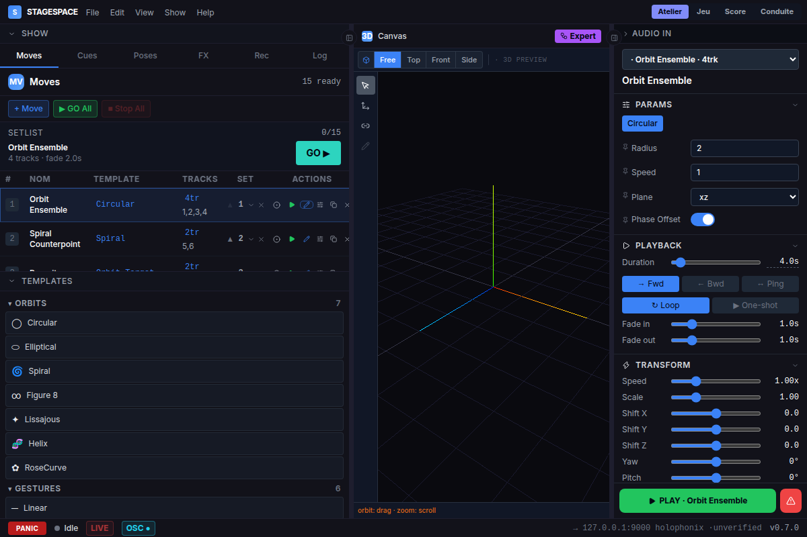

- **Titlebar + menubar** (File / Edit / View / Show / Help): show files
  (New/Save/Load `.hfg`, Import .hol, recent shows), undo/redo and
  clipboard, surface and viewer toggles, contextual Show actions. Live
  safety is always in the StatusBar instead (LIVE/DRY-RUN + PANIC).
- **SHOW column**: Moves / Cues / **Poses** / FX / **Rec** / **Log** tabs
  — template library (ORBITS, GESTURES, …) below the Moves tab.
- **3D canvas** in the center.
- **Inspector** (right): Params, Playback (duration/fades/loop/end/anchor),
  Transform, Audio, Tracks (pattern selection: All / None / 1 of 2 / Odd /
  Inverse / 1st half / 2nd half…).

### 2.3 Creating a move

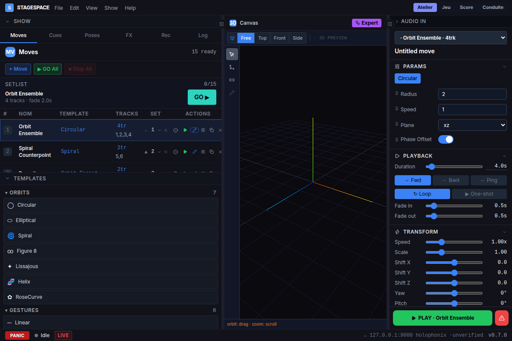

`+ Move` creates a slot — pick a **template** (left), assign **tracks**
(numbered grid), set the **params** and **fades** (slot fade in/out),
then `▶ PLAY · Move n`.

### 2.4 Expert — the graph editor

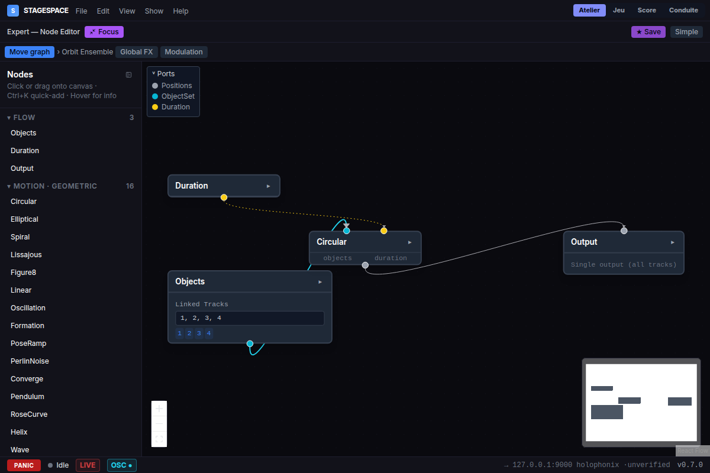

The **Expert/Simple** toggle opens the node editor:

- **Tabs**: `Move graph` (the edited slot's graph) · `Global FX` (global
  post-processing) · `Modulation` (signal graph).
- **Palette** (left): nodes by category — click to add, or **drag to the
  canvas** (dropped at the cursor; **dropped on a wire = spliced into the
  chain**). **Ctrl+K** quick-add, right-click a node on the canvas =
  runnable examples.
- **Canvas**: drag connections between ports — **inputs on top, outputs
  on the bottom** (Max/MSP convention). `Ports` legend top-left, minimap
  bottom-right. A selected node edits in the Inspector (NODE section).
  **Double-click a node's title = rename the instance** (the name is
  documentary — persisted in the show, ignored by the backend).
- **Wire-drop → quick-add**: dropping a wire on empty canvas opens the
  quick-add **filtered to the wire's port type** — the chosen node is
  placed at the drop point, already wired (plugdata gesture). Works both
  ways (dragged from an output or an input). Exception: pulling a wire
  off an **already-wired input** and dropping it on empty space
  **removes the connection** ("pulling the cable", Max semantics).
- **Autopatch**: three ways to insert `A → M → B` — selected edge +
  palette click, **palette drop onto a wire**, or **double-click a wire**
  (quick-add filtered to both endpoint types, inserted at the click
  point).
- **Reconnect**: dragging an edge endpoint moves it to a new target —
  dropped on empty space, it **removes** the edge.
- **Wire-cutting**: **Alt+drag across wires cuts them** (crosshair
  cursor while Alt is held).
- **Delete-heal**: deleting a mid-chain node (`Delete` or cut)
  **re-heals its neighbours** `A → B` when the port types match —
  plugdata semantics. Nodes with multiple inputs/outputs or incompatible
  types: clean cut.
- **Frames**: the `▭ + Frame` button (palette footer) places an
  **annotation frame** — movable, resizable (handles when selected),
  renamable by double-clicking its title. UI-only: never sent to the
  engine (filtered from every backend payload) but **persisted in the
  show** — the frame survives save/reload.
- **Clipboard**: `Ctrl+C/X/V` copy/cut/paste selected nodes (with their
  internal edges — paste works in another tab), `Ctrl+D` duplicate.
- **Undo/redo**: `Ctrl+Z` / `Ctrl+Y` in **all 3 tabs** — the Global FX
  and Modulation histories merge bursts (a continuous drag = one
  entry), cap 50.
- **Diagnostics**: the errors/warnings badge top-right lists the graph's
  problems — **clicking an issue focuses and selects the offending
  node** on the canvas.
- **Save** stores the graph in the slot — hot-swap: if the move is
  playing, the new graph replaces the old one with a fade.

### 2.5 Jeu — busking pads


The pad wall (center, **Pads** tab) is the busking instrument: numbered
pads `#n` (= stable `oscIndex` — doesn't change on reordering).

- **Pad body — tap** = play/stop · **hold ≥350 ms** = momentary inversion
  (stopped pad = bump while held; live pad = punch-out, release re-fades)
- **Name strip** (bottom of the pad) = select the move for the live
  drawer — touching it never affects the transport
- **S** = solo · `/stagespace/slot <n>` · `/solo` · `/unsolo` from the console
- Per-slot fades (configured in the Playback scope)
- Control-source badges per track: **P** parked, **H** held

### 2.6 Poses — position presets

A **pose** is a named snapshot of track positions (backend-owned,
saved in the `.hfg`). Poses are busking material: instant or animated
recall, partial by nature — tracks outside the pose don't move.

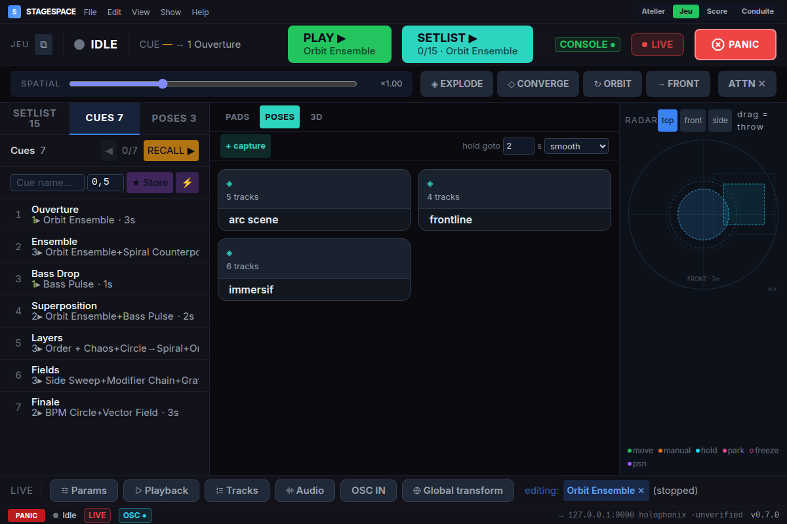

- **Capture**: type a name in the left-column **POSES** tab (`● cap`) or
  hit **+ capture** in the pad wall header — the capture modal embeds a
  track picker (all checked = capture every known position, including
  tracks added later). Captured positions are the live ones: manual,
  move holds, or moving objects.
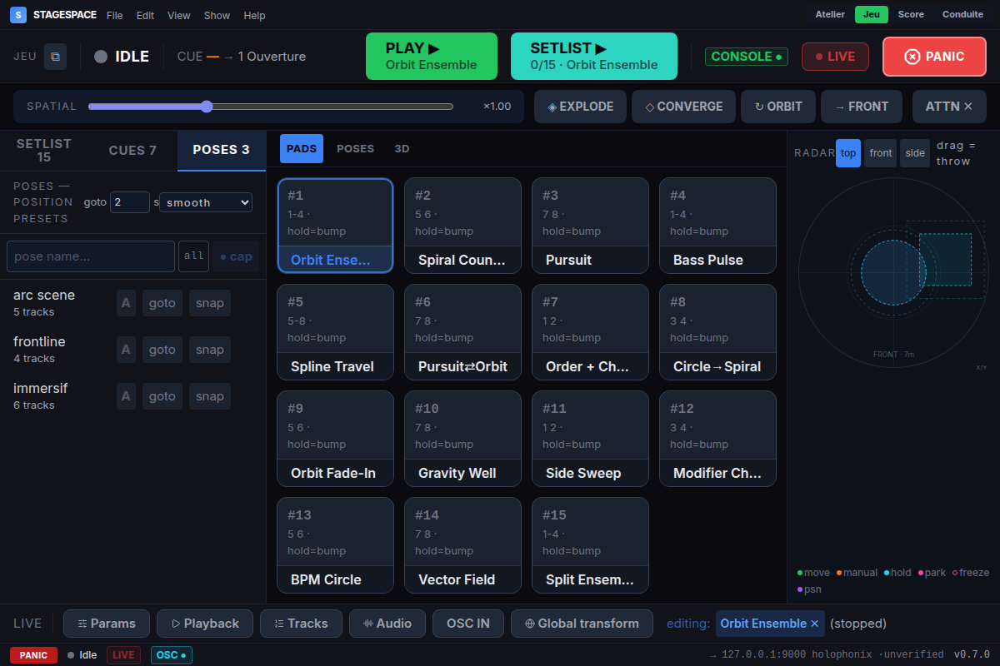 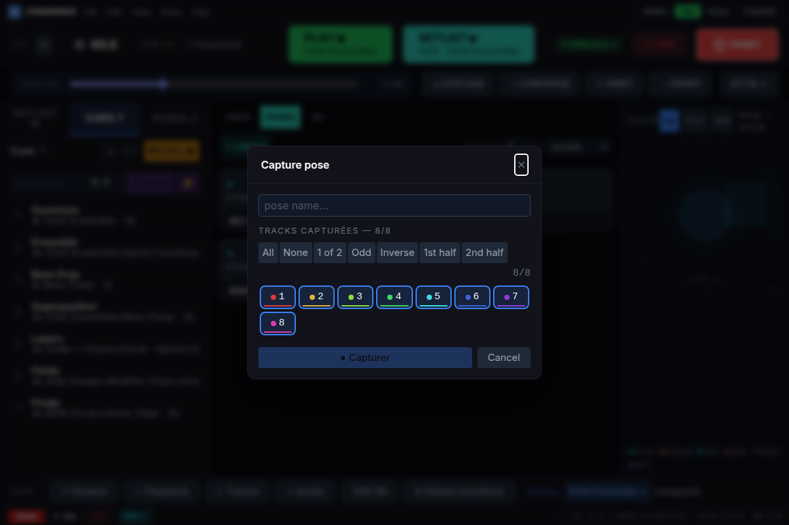

- **Recall** per pose row (Poses panel): **snap** = instant (manual
  positions) · **goto** = animated ramp, duration and easing chosen in
  the panel header · **A→B morph** = pick a source pose `A`, then morph
  it into any other pose (objects absent from the source start from
  their live positions).
- **Pose-pads wall** (center, **Poses** tab — console-light palette
  spirit): **tap** = snap · **hold ≥350 ms** = goto with the wall's
  duration · **name strip** = ghost preview (targets shown as dotted
  circles in the 3D and radar viewers — requires the *Fantômes* viewer
  setting, on by default).
- **Easings** for goto/morph: 8 curves selectable in the pad wall header
  and the Poses panel — `smooth` (default, zero velocity at both ends),
  `linear`, `ease_in`, `ease_out`, `ease_in_out`, `expo_in`, `expo_out`,
  `overshoot` (elastic arrival — overshoots the target).
- A pad/row warns `patched/total ⚠` when some of the pose's tracks are no
  longer patched — those are skipped at recall.
- Composing poses with nothing playing: enable **Idle tracks** in the
  *View* menu — objects without a move stay visible (ghosted at their
  origin) so you can drag them into place before capturing.
- OSC: `/stagespace/pose/capture|snap|goto|morph|list` (see section 8).

### 2.7 Conduite — the FOH view

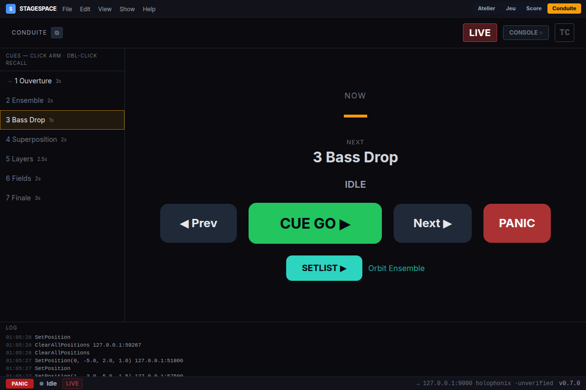

NOW (current cue, amber — or the busked moves when no cue is current),
NEXT (the cue GO will fire), `pre_wait`/`follow` timers, TC, status.
Console arm/go model: click a cue = **arm**, **Prev/Next move the armed
marker without firing** — **GO fires the armed cue** (or the next one if
nothing is armed). Double-click a cue = immediate recall. The center shows
the **audition radar** of the armed cue (where it will place objects,
nothing emitted). **SETLIST ▶** is a separate button — setlist crossfade,
distinct from CUE GO. TC chip toggles chase; UNSOLO appears when a solo
is active; the operational log scrolls at the bottom.

### 2.8 Detachable windows — the second screens

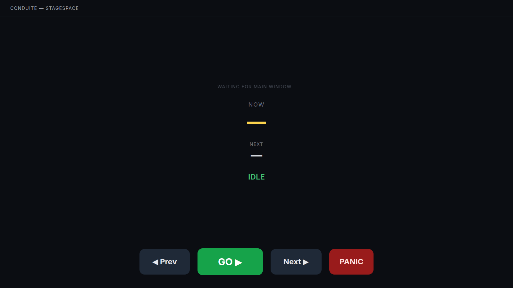

**⧉** button (conduite header, or jeu topbar): the same surface in a
**dedicated window** — the conduite for a FOH screen, the jeu
(pads + radar) for a performer screen. If the main window isn't
broadcasting yet, the detached conduite shows **"WAITING FOR MAIN
WINDOW…"** — no blank page. DRY-RUN / PARKED / CONSOLE / TC chips
identical to the overlay.

### 2.9 Coordinates & viewers

- **Coordinate convention**: the origin is the **sweet spot** in the
  audience; **+y** points in the direction of the audience's gaze toward
  the scene (upstage — the stage front is therefore at −y); **x** is the
  lateral axis, **z** is height (up). Units are meters.
- **Viewer orientation** (Settings → *Show* → *Visualiseurs*): top and
  side views can put **+Y at the top of the screen** (`upstage-up`,
  default) or **−Y** (`downstage-up`) — the 3D viewer and the radar always
  stay consistent with each other.
- **View menu toggles**: **Trajectories** — sampled move paths in the 3D
  viewers (off = clean scene, no backend sampling) · **Idle tracks** —
  objects without a playing move stay visible (manual positions solid,
  origins as ghosts) — needed to compose poses when nothing plays.
- **Visualiseurs** settings: *Focus* dims objects outside the edited move
  (instead of hiding them) · *Fantômes* shows resting objects at their
  origin and the selected pose's targets as ghosts.

---

## 3. Two ways of working

### A. Console conduite — the engineer drives from their console

The console emits `/stagespace/*` OSC commands; STAGESPACE follows.
The laptop is for soundcheck and monitoring — not for live driving.

```
Console snapshot → OSC → STAGESPACE executes the cue
                           ↘ feedback → ack/nack + current cue
```

- **CONSOLE ● indicator**: green = last show-control command < 5 s — the
  console link is visible at a glance.
- **NACK**: any refused command (`busy`, `not-found`) is sent back to the
  sender — the console knows when something wasn't executed.
- Integration docs: `docs/console-integration.md`.

### B. Busking — non-timecoded concert, on inspiration

Slots are prepared at soundcheck, fired by number or by finger.

- **Layers**: moves play in parallel — overlay a swarm on an orbit.
- **UNSOLO**: replays the slots stopped by the last solo.
- **STOP ALL**: stops all moves with a fade (less brutal than PANIC).
- **Live expression**: macros (scale/shift/rotation/speed), manual
  positions, external faders via OSC-IN mappings.

---

## 4. Cues in detail

- **Full** = replaces the whole state (moves, channels, graphs, macros,
  mappings).
- **Tracking** = merges by object index — only touches what's recorded in
  the cue (scope by categories). Never stops unlisted moves.
- `pre_wait`: wait before execution (shown as a countdown).
- `follow`: automatic chaining to the next cue.
- `timecode`: the cue fires when the TC arrives (fps 24/25/30,
  TC-originated skips the pre_wait).
- **Arm**: single click = arm; the recall goes to the armed cue (or the
  next one).

---

## 5. Spatial gestures & live expression

Direct expression commands — usable from the console or busking:

| Message | Effect |
|---------|-------|
| `/stagespace/throw <obj> <vx> <vy> <vz>` | throws object *obj* with a velocity (ballistic — it drifts and comes back) |
| `/stagespace/spatial <k>` | global spatial compressor: `k<1` tightens the field, `k>1` expands it — live gesture |
| `/stagespace/attention <obj>` | freezes all other objects — a single one moves (*change blindness*); `/attention/clear` releases |
| `/stagespace/gesture <name> [strength]` | composed gesture in one command: `explode` · `converge` · `orbit` · `front` — velocity computed per object |
| `/stagespace/soundcheck [start\|stop\|next\|prev]` | cyclic per-track probe — walks a ping through each track (spatial identification); default `start` |
| `/stagespace/rehearsal <action>` | Score recorder — alias `/stagespace/record` (see below) |

 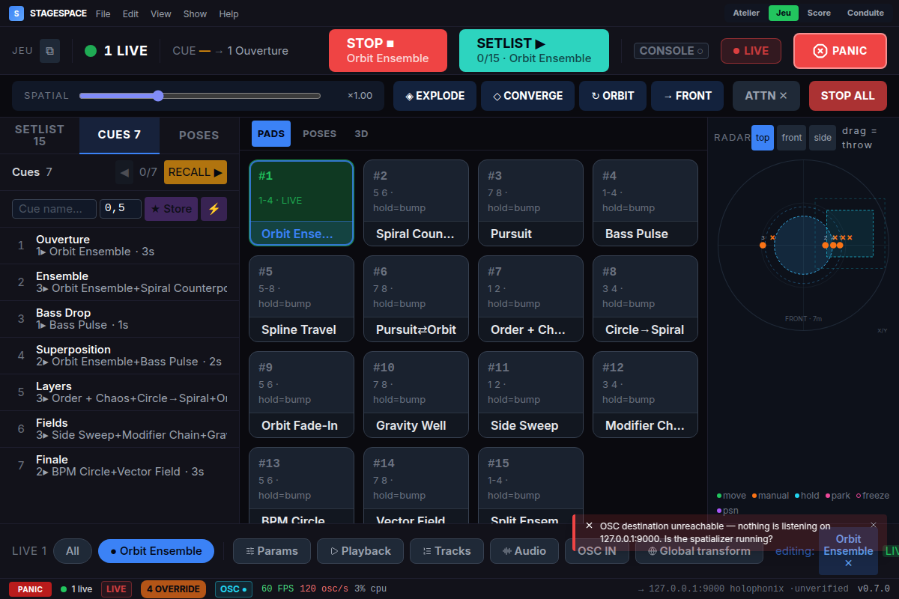

**Score recorder** (`/stagespace/rehearsal <action>`, UI in the **Rec**
tab of the atelier SHOW column) — busking capture:

- `record` — starts capturing the live actions (slots, cues, gestures,
  positions, macros) as timestamped references
- `stop` — closes the take and **materializes it as clips/curves of the
  Score timeline** (appended at the end of the partition, editable —
  saved in the `.hfg`); outside a recording, `stop` stops the score
- `play` — plays the partition (Score transport)
- `clear` — empties the partition

**Pos-tape** (same Rec panel, *Tape* row — UI-only, no OSC command) —
raw position stream for a remote rehearsal or a renderer-side bounce:
`rec` captures the positions actually emitted @30 Hz, `play` replays the
tape at real pace (injected into the merge), `↓ export` writes a
`.sstape.json`, `↑ import` replays a tape file.

## 6. Interactive controls (surfaces)

Beyond buttons, several direct controls on the surfaces:

- **2D radar** (Jeu view — right panel): live merged positions in
  **top** (X/Y), **front** (X/Z) or **side** (Y/Z) projection — selector
  in the panel header — colored by control source
  (move/manual/hold/park/freeze).
  **Drag an object = grab & throw** — you physically throw the source.
- **GestureStrip** (Jeu view): **spatial compression** slider `k`
  (tighten/expand the field live) + EXPLODE/CONVERGE/ORBIT/FRONT gesture
  buttons + attention-stasis release — shared with the `?view=run` window.
- **LiveDrawer** (bottom of the Jeu view): scoped panels — Params /
  Playback / Tracks / Audio of the selected move + OSC IN mappings +
  Global transform — the canvas stays visible while tweaking (no modal).
- **Manipulate / Transform** (3D viewer toolbar, manipulate mode):
  **global** merge macros (speed, scale, shift, rotation, radius, height —
  affects all live moves) + *clear overrides* of manual positions.
- **OVERRIDE chip** (StatusBar, all surfaces): a dragged object is
  **held manually** (merge-priority, it stays frozen) — the chip lists
  every manual/hold/freeze override and lets you **release** each one
  with a click. Ctrl+click an object releases it too.
- **ObjectInspectBar**: clicking an object (3D or radar) → inspect —
  source state (manual/move/hold/park/freeze), position, per-mode
  release buttons. Per-object detail without opening the Inspector.

## 7. "Continuous" move semantics

Two flags per move/slot (**Playback** scope of the live drawer, or
Playback section of the atelier Inspector):

- **`End: hold`** — at the end of a one-shot (or on operator stop), the
  last positions become manual positions: the object **stays where the
  move left it** (`revert` by default = return to base position). A hold
  move never runs the fade-out contraction; panic bypasses end_mode
  unconditionally.
- **`Anchor`** — where the trajectory starts from, four modes:
  - `origin` (default) — the move's own origin, as authored;
  - `current` — at launch, each object captures its current position as
    anchor (`delta = captured − traj(0)`): the move starts **from where
    the object is**, no jump — move→move chaining, release/peg-out style;
  - `follow` — the move's origin **continuously follows** a target track
    (track number field), re-read every frame — the orbit stays centered
    on a moving object (spatial follow-me);
  - `pose` — starts where a named pose places the objects (pose picker;
    objects absent from the pose fall back to their live position).

Combined, `hold` freezes the object at the arrival point and `current` (or
`pose`) starts the next move from that point — "continuous" conduite
without teleportations.

---

## 8. OSC show-control reference (`/stagespace/*`)

Incoming port = `oscInPort` (default 8001). Reserved prefix — intercepted
before your user mappings.

| Message | Effect |
|---------|-------|
| `/stagespace/go` | setlist GO (= Enter) |
| `/stagespace/cue/next` · `/prev` | next / previous cue |
| `/stagespace/cue/recall <n> [fade]` | cue by number/name or index; optional `fade` |
| `/stagespace/slot <n>` · `/slot/stop <n>` · `/solo <n>` | busking: play / stop / solo slot `#n` |
| `/stagespace/unsolo` | restore slots stopped by the last solo |
| `/stagespace/park <i>` · `/unpark <i>` | object index *i* (0-based) out of recalls |
| `/stagespace/position <i> <x> <y> <z>` | manual position of object *i* (operator takeover) |
| `/stagespace/position/clear <i>` · `/position/clearall` | removes the manual position |
| `/stagespace/trackpos <t> <x> <y> <z>` | origin position of track *t* (where panic returns it) |
| `/stagespace/pose/capture <name> [track…]` | capture live positions into a named pose (all known tracks if none passed) |
| `/stagespace/pose/snap <name>` | instant pose recall (manual positions, partial — untouched tracks don't move) |
| `/stagespace/pose/goto <name> [dur]` | animated ramp to the pose (default 2 s, holds the target at the end) |
| `/stagespace/pose/morph <from> <to> [dur]` | animated morph pose A → pose B |
| `/stagespace/pose/list` | dump poses → `/stagespace/pose/state <name> <ntracks>` per pose (backend-direct) |
| `/stagespace/macro <name> <v>` | merge macro: speed, scale, shift_x/y/z, yaw/pitch/roll, radius_scale, height_offset |
| `/stagespace/cue/arm <n>` · `/cue/go` | arm a cue without firing it · fire the armed one (console model) |
| `/stagespace/positions` | dump emitted positions → `/stagespace/pos/state <obj> <x> <y> <z>` (backend-direct) |
| `/stagespace/view <s>` | switch the operator surface: `atelier` · `jeu` · `score` · `conduite` |
| `/stagespace/show/load <path>` | load a `.hfg` — **path local to the STAGESPACE machine** (alias `/stagespace/load`) |
| `/stagespace/timecode/chase <0\|1>` · `/timecode/fps <n>` | chase on/off · fps of the string format (24/25/30, default 25) |
| `/stagespace/score/chase <0\|1>` | score transport chases incoming timecode (locate/rebase/auto-start) |
| `/stagespace/spatial` `attention` `throw` `gesture` `soundcheck` `rehearsal` | spatial & rehearsal actions |
| `/stagespace/arm` · `/disarm` | OSC output / **dry-run** |
| `/stagespace/status` | re-send current/next cue to the requester |
| `/stagespace/timecode <s \| "HH:MM:SS:FF">` | timecode → chase |
| `/stagespace/panic` · `/stop` | blackout / stop all |

**Feedback**: `ack` on accepted command; `nack <reason>` on rejection;
`cue/current` + `cue/next` on every change and on `status`. The 4 most
recent controllers receive feedback.

### Keyboard shortcuts

`Space` play/stop selected slot · `Enter` setlist GO · `Shift+Enter`
recall next cue · `Backspace` previous cue · `Esc` **panic** ·
`Ctrl+S`/`Ctrl+O`/`Ctrl+N` save / load / new show (fire even while
typing, blocked while a modal is open) ·
`Ctrl+Z`/`Y` undo/redo · `Ctrl+K` quick-add node · `Ctrl+C/X/V/D` node clipboard ·
`Ctrl+C`/`Ctrl+V` copy/paste the **position** of the selected object · `?` cheatsheet

---

## 9. OSC-IN mappings + Learn

Wiring an external fader — *OSC IN* scope of the live drawer (Jeu view):

| Destination | Effect |
|-------------|-------|
| `handler:name` | stored value — readable from the signal graph |
| `macro:scale` (shift/yaw/speed…) | merge macro — all live moves |
| `channel:gain:3` (gain/spread/distance/presence…) | channel of object 3 |
| `position:2` | manual position of object 2 (override) |

- **LEARN**: type a destination, click LEARN, move the fader —
  the address fills itself in (10 s timeout).
- **Live values** shown next to each mapping.
- ✎ edits · `enabled` checkbox disables without deleting.

---

## 10. Live safety

- **Panic (Esc / PANIC)**: stops all moves + sends back origin positions.
- **Dry-run / ARM**: everything runs, nothing goes out to the renderer —
  the `LIVE`/`DRY-RUN` indicator is **always visible** in the StatusBar.

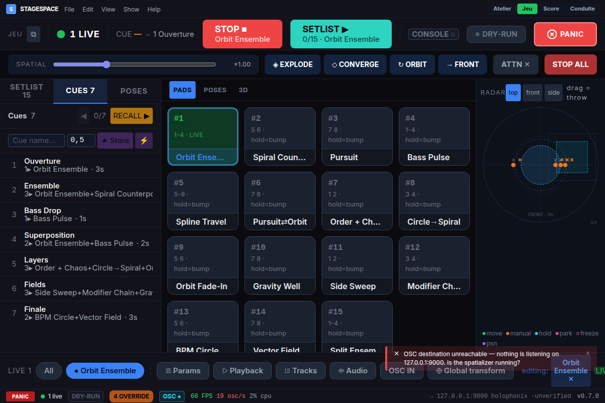
- **BACKEND ✕**: a backend command failed silently — the engine is
  probably unresponsive. Returns to green on the first successful IPC.
- **Park**: a hand-held object escapes recalls — **PARKED** chip
  (StatusBar + conduite). `park` survives panic by design.
- **Confirmations**: every destructive action (delete slot/template,
  clear-all zones/modulations/channels, per-item remove) goes through a
  confirmation box — no more single-click deletes.

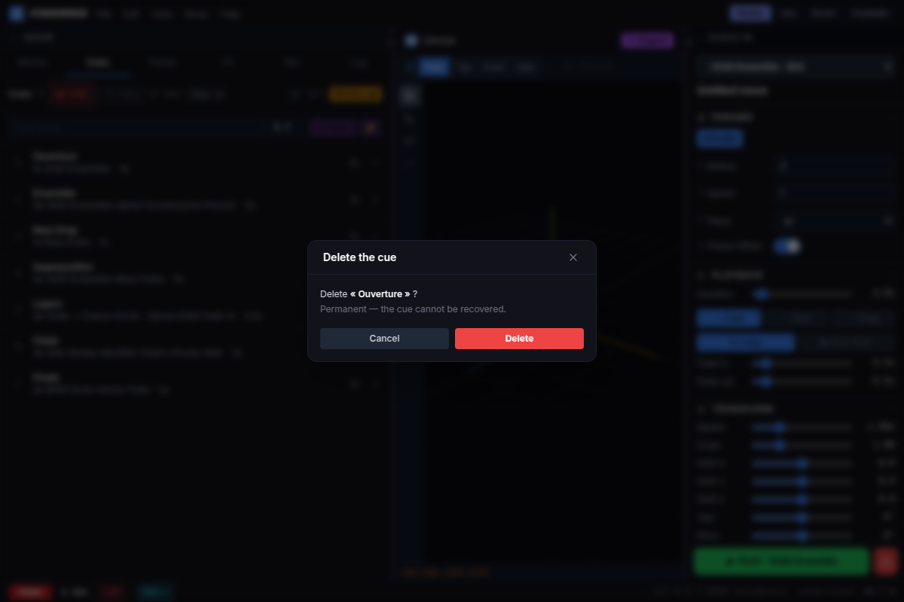

- **Recall guards**: during a recall, slot/cue commands are rejected
  (`nack busy`) rather than interleaved — never an orphaned movement.

---

## 11. Troubleshooting

| Symptom | Likely cause | Check |
|----------|----------------|----------|
| Object no longer moves on recalls | Forgotten park | **PARKED** chip |
| "I pressed and nothing happened" | Recall in progress or missing slot/cue | `nack` sent back to the controller |
| Console unresponsive | Dead OSC link | **CONSOLE ●** indicator gray = >5 s |
| `TC lost` | No `/stagespace/timecode` for >1 s | TC source + `oscInPort` |

Backend failures surface as **sticky toasts** (bottom-right) — graph
validation, failed show load, panel crash. A rejected OSC command gets a
`/stagespace/nack <reason>` back to the sender.


| Move playing in silence | Tracks outside OSC list / dry-run | `LIVE` vs `DRY-RUN` + OSC destination in StatusBar |
| Everything frozen, unresponsive | Dead backend | **BACKEND ✕** chip in StatusBar |
| Black conduite window | Main window closed / not broadcasting | "WAITING FOR MAIN WINDOW…" |
| Graph not applied to live | Failed hot-swap | Error pill in StatusBar (persists after the toast) |

---

## 12. Files & persistence

| What | Where |
|------|-----|
| Full show (graphs, slots, cues, poses, score, OSC, FX) | `.hfg` file — File menu save/load (`Ctrl+S`/`Ctrl+O`) or `/stagespace/show/load <path>` |
| Holophonix project | `.hol` (import — source of truth for tracks) |
| Graph auto-save while editing | on every structural change |
| Slots | localStorage (persisted between sessions) |
| UI & viewer preferences (legend, collapsed, orientation…) | localStorage `stagespace.*` |

---

## 13. Example conduite

`examples/conduite-epilogue.hfg` (+ `.md`): ~1 h 25 show, 19 cues,
14 moves, two acts + intermission — TC, follow, tracking, safety cue S1.
Import it to explore every mechanism.

Four additional scripted conduites (`docs/conduites/*.md`):
`orbe-acousmatique.hfg` (24 tracks, 8 slots, 6 cues) · `grid-dj-spatial.hfg`
(16 tracks, TC chase, busking) · `sillage-theatre.hfg` (tracking cues, PSN) ·
`traverse-multimedia.hfg` (master TC, canon, finale). They also load via
`/stagespace/show/load examples/orbe-acousmatique.hfg`.


---

# Appendices

## A. Node reference

Nodes are added from the palette (or `Ctrl+K`). **Inputs on top, outputs
on the bottom.** Ports are typed (Positions, ObjectSet, Duration,
Signal…) — only valid connections are accepted.

### A.1 Structural — the graph's backbone

| Node | Role |
|------|------|
| `Objects` | source: the move's object/track list |
| `Duration` | move duration — required to play |
| `Output` | output: last node before the runtime |
| `Group` | groups nodes into a subset |
| `Mix` | mixes two position streams (weighting) |
| `Sequence` | chains moves over time |
| `Crossfade` | blend between two inputs |

### A.2 Math engines — generated trajectories

`Circular` · `Elliptical` · `Spiral` · `Lissajous` · `Figure8` · `Linear` ·
`Oscillation` · `PerlinNoise` · `Formation` (group formations:
line/arc/grid) · `Converge` (convergence toward a point) · `Pendulum` ·
`RoseCurve` · `Helix` · `Wave` · `CustomTrajectory` · `PoseRamp`
(per-object ramp to a named pose — the engine behind pose goto/morph)

### A.3 Physics engines — simulation

`Bouncing` (bounces) · `Spring` (spring) · `Follow` (pursuit) · `Swarm`
(flock/boids) · `Avoidance` (mutual avoidance) · `VectorField` (vector
field)

### A.4 Splines — drawn trajectories

| Node | Role |
|------|------|
| `DrawSpline` | holds the hand-drawn points (draw mode) |
| `EvaluateSpline` | evaluates the spline → f(t) positions |
| `TrimSpline` | extracts a portion of the spline |
| `OffsetSpline` | offsets the spline in space |

### A.5 Envelopes (ex-Falloffs) — spatial/temporal influence

`TimeFalloff` (envelope over time) · `PointDistanceFalloff` (influence by
distance to a point) · `DirectionalFalloff` · `AudioAmplitudeFalloff`
· `AudioFalloff` — an envelope modulates the influence of any parameter.

### A.6 Modifiers — transformations

`Scale` · `Rotate` · `Offset` · `PhaseShift` · `Mirror` · `Clamp` · `LFO` ·
`Jitter` · `SpeedScale` · `Delay` · `Freeze` · `Switch` · `RadiusScale` ·
`HeightOffset` · `PerTrackDepth` · `Barycenter`

### A.7 Sources — external data

`BPM` (audio-IN tempo detection) · `AudioAmplitude` · `AudioSpectrum`
(per-band FFT) · `OSCInput` (incoming OSC value)

### A.8 Global (post-process) — Global FX graph only

| Node | Role |
|------|------|
| `Merge` | resolution strategy when several moves target the same track (override/crossfade/blend/priority — last writer wins) |
| `Zone` | declares a spatial zone for the Spatial FX panel |
| `Velocity` | declares a velocity modulation channel |
| `ManualPosition` | manual position override — reads 3D drags (hand positioning) |

### A.9 Composite & plugins

`MoveRef` (references another move — movement composition) · `Plugin`
(external WASM engine packaged as `.ssx`)

### A.10 Signal — modulation graph (*Modulation* tab)

The signal graph produces **scalar f(t) values** that modulate the
parameters of any node in the position graph — LFO on the radius, audio
on the speed, etc.

Sources: `SignalConst` · `SignalTime` · `SignalLfo` · `SignalAudio` ·
`SignalOsc` (OSC-IN handlers) · `SignalRandom` · `SignalCounter`
Processing: `SignalMath` · `SignalMap` (min/max remapping) · `SignalClamp` ·
`SignalMix` · `SignalSlew` (smoothing) · `SignalEnvelope` · `SignalThreshold` ·
`SignalBeat` · `SignalSampleHold` · `SignalMux`
Output: `SignalOut` — the named output becomes targetable from a node
parameter.

Typical chain: `SignalLfo → SignalMap → SignalOut(speed)` then in the
position graph, an engine's `speed` parameter binds to that output.

---

## B. Draw mode — drawing a trajectory

1. Add a drawable node to the edited graph (`DrawSpline`,
   `EvaluateSpline` or `VectorField` in `drawn` mode) — Expert palette or
   spline preset.
2. The canvas 3D's **Draw** button activates — click it: the canvas
   enters drawing input (Manipulate/Assign are excluded).
3. Draw with the mouse — captured points fill `DrawSpline.params.points`.
4. Wire `DrawSpline → EvaluateSpline → Output` if not already done.
5. **Exit Draw** (dedicated button or `Esc`) leaves the mode.
6. The drawn ghost trajectory disappears on exit — what you see next is
   the move's real trajectory.

---

## C. Global FX graph

The *Global FX* graph (node editor tab) produces no trajectory — it
**post-processes** the final merge of all moves:

- `Merge` sets the resolution strategy for contested tracks.
- `Zone` injects *designed* zones into the spatial engine (`graph_zones`,
  evaluated before the panel FX's drawn zones — see appendix D).
- `Velocity` declares the kinematic modulations (speed/accel→channel)
  listed by the FX panel.
- Global modulations (ensemble macros) apply after the merge —
  a fader's `macro:scale` acts on all moves simultaneously.

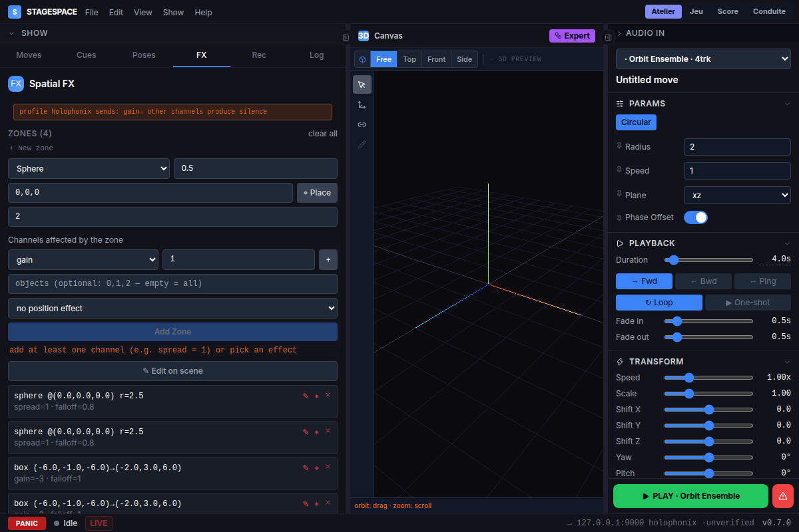

## D. Spatial FX — end-to-end workflow

Spatial effects share the same evaluation engine (per-zone SDF
influence, channel fusion) but have **two creation paths** —
declarative in the graph, interactive in the viewer:

### D.1 Two zone sources, one engine

| | `Zone` node (Global FX) | Drawn zones (FX panel + 3D) |
|---|---|---|
| Creation | Node editor, **Global FX** tab | **FX** panel (SHOW column): `Add Zone` or `Place` → click in 3D; then drag = move, scroll = resize |
| Parameters | `shape` sphere/box, center/radius or min/max, `falloff`, `channels`, `objects`, `enabled` | same + **positional effects** (`repel`, `attract`, `dampen`, `vortex`) — move the objects, exclusive to drawn zones |
| Evaluation | `graph_zones` — replaced wholesale on each graph push, evaluated **before** drawn zones | `zones` — persistent until deleted, evaluated after |
| Persistence | `globalGraph` in the `.hfg` | `zones` array in the `.hfg` |

**Rule of thumb**: the `Zone` node for *designed* effects (reproducible,
versioned in the show) — drawn zones for *live sculpting* in rehearsal
(and the positional effects the node lacks). Both add up in the runtime
merge.

### D.2 The FX panel (SHOW column)

- **Zones**: the form has two modes, always indicated — `+ New zone`
  (creation) or `✎ Editing zone n` (modification, `Update zone n` button,
  `✕ new zone` to exit). `✎` on a zone row loads its parameters into the
  form — the position fields follow that zone's 3D moves while editing;
  `⌖` re-places the center in 3D; `Edit zones` = direct 3D move/resize.
  `clear all` and every `×` go through a confirmation.
- **Modulations**: kinematics — `speed`/`accel`/`jerk`/`angvel` →
  channel. **Declared by the global graph's `Velocity` nodes** (editing
  in the node editor, Global FX tab); the panel lists them read-only.
- **Object channels**: gain/spread/distance/presence per object — the
  spatial equivalent of a fader per track.
- **Readback**: the effective channels shown = static ⊕ modulated ⊕
  zones — the real combined effect of the three sources is visible live.

## E. External trackers (PSN)

STAGESPACE consumes the **PosiStageNet** (PSN) protocol for actor/dancer
tracking — trackers appear as position sources (tracker_map) and can
drive Follow moves or object positions. The `sillage-theatre` scenario
uses it to follow the dancers.

## F. `.ssx` plugins (WASM engines)

External engines packaged `.ssx` (WASM) go in the app's `plugins` folder —
they appear as a `Plugin` node in the graph and compile like native
engines. SDK: `plugin-sdk/` + `plugin-examples/`.

## G. Advanced config (backend)

| Command / setting | Role |
|--------------------|------|
| **Venue mapping** (`set_venue_config`) | outgoing transform: `enabled` + `scale [x,y,z]` + `offset [x,y,z]` + `yaw` — canonical space → venue geometry mapping |
| **Distance reality** (`set_distance_reality`) | perceptual effects by distance: exaggeration, gain_atten, air_loss — `None` = disabled |
| **Media sync** (`set_media_sync`) | cue-change outbound feed to a light/video desk (`{prefix}/cue <num> <name>`) |
| **Presets** (`preset_save/load/list/delete`) | saved named configurations — quick settings recall |
| **Renderer discovery** | `Discover renderers` in Settings — scan available OSC outs |

## H. Monitoring panels

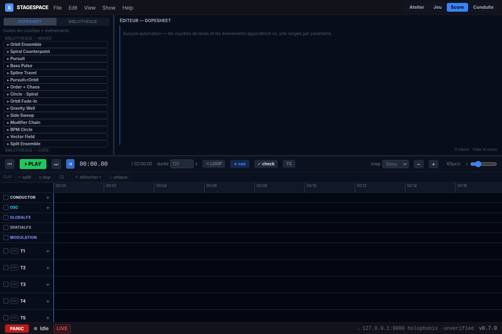

- **Score** — the multitrack sequencer surface (a first-class surface,
  not a panel): clip timeline (move
  slots, cues, markers per lane), automation curves, transport
  (play/seek/loop/TC chase). Ruler interactions: drag = scrub
  (works while playing), loop region edges + body draggable,
  named markers (`M` drop, drag, right-click rename/delete,
  `,`/`.` navigate). Keyboard: `Home`/`End` bounds, `←`/`→` nudge
  at snap step (`Shift` ×10), `L` loop, `I`/`O` loop bounds at
  cursor, `S` split clip. Snap step selector (`libre`→`1s`), zoom,
  follow auto-scroll. Clip inspector: envelope (draggable
  fade-in/tail handles), slot playback params (editable when
  stopped, amber "applies at next play" indicator when the slot
  changes during playback).
- **Rec** (atelier SHOW column) — the Score recorder (busking capture →
  timeline clips) and the position tape (30 Hz stream, export/import) —
  see section 5.
- **Log** (atelier SHOW column) — history of show commands (GUI +
  received OSC `/stagespace/*`) — each entry timestamped. The
  **CONSOLE ●** indicator reflects activity.
- **Audio** — audio capture state (device, level, detected BPM).

## I. Settings reference

The Settings modal (*Edit → Preferences…*, or click the OSC destination
in the StatusBar) is organized in tabs:

| Tab | Contents |
|-----|----------|
| **Réseau** | **OSC output** — renderer host:port + profile (Holophonix/IEM/Spat/ADM/generic XYZ/generic AED) + *Discover renderers* · **OSC input** — command receive port (`oscInPort`, default 8001) · **Media sync out** — sends `{prefix}/cue <num> <name>` to a light/video desk on every cue change · **Remote UI** — serve the UI to remote browsers over HTTP (no authentication — trusted networks only) |
| **Tracking** | **PSN / RTTrP** — enable, multicast group + port, tracker→track map (`1:7, 2:8`), axis permutation (`x,-y,z`) |
| **Salle** | **Venue adaptation** — scale/offset/yaw applied to the OSC payload only (trajectories stay canonical) · **Distance reality** — perceptual distance effects strength |
| **Show** | **Merge** — default strategy: override · crossfade · blend · priority · **Track IDs** — virtual IDs when no `.hol` is loaded (comma-separated, e.g. `1,2,3,…`) · **Visualiseurs** — Focus dim, Fantômes (resting origins + pose ghosts), top/side orientation (+Y or −Y up — see section 2.9) |
| **Audio** | input device for audio-reactive trajectories (BPM, amplitude, spectrum) |
