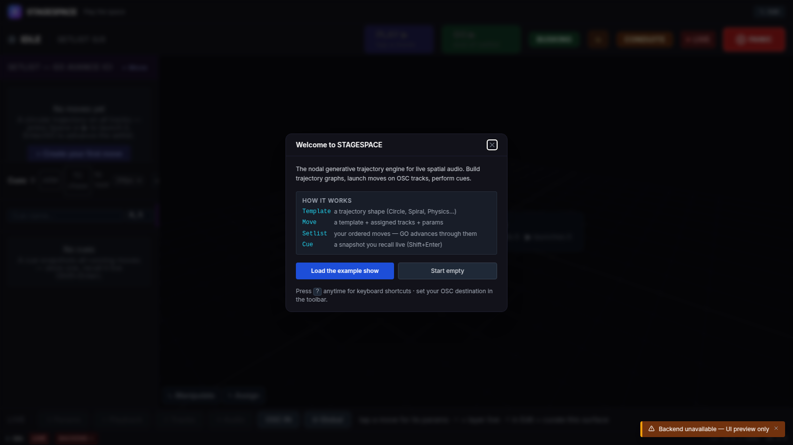
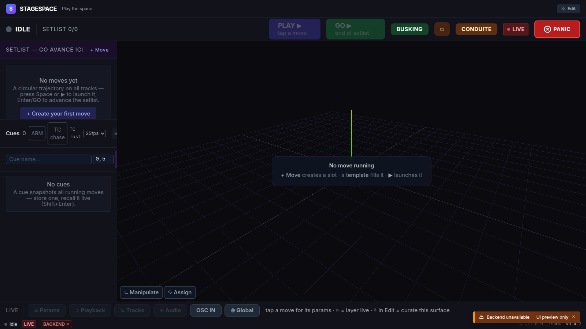
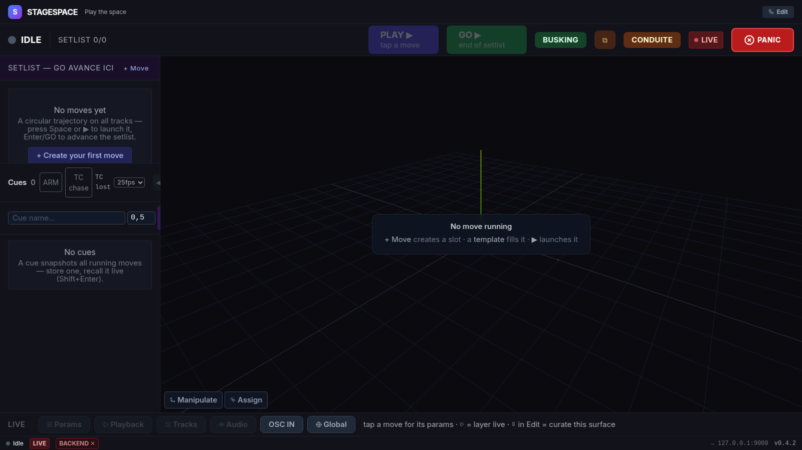
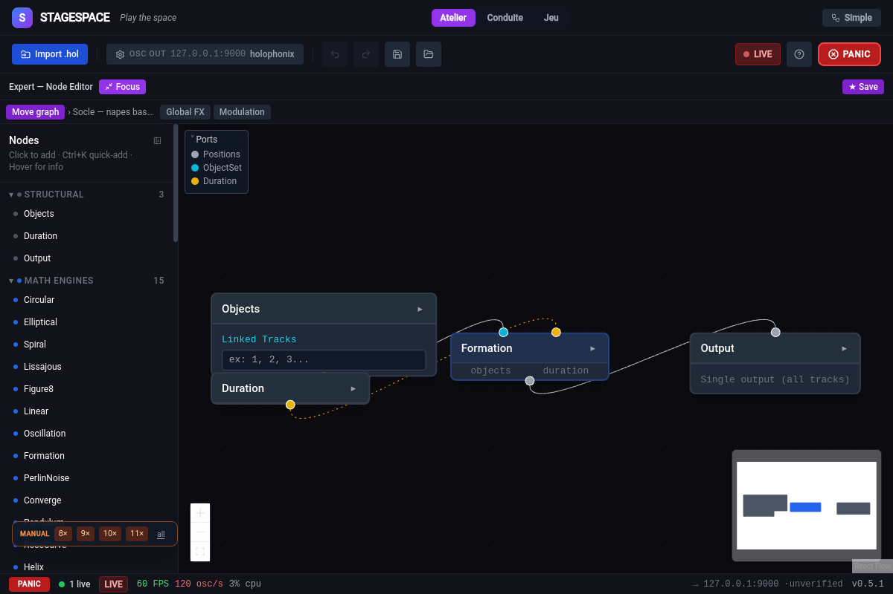
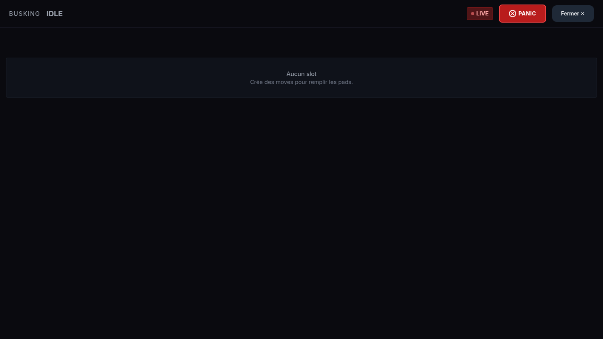
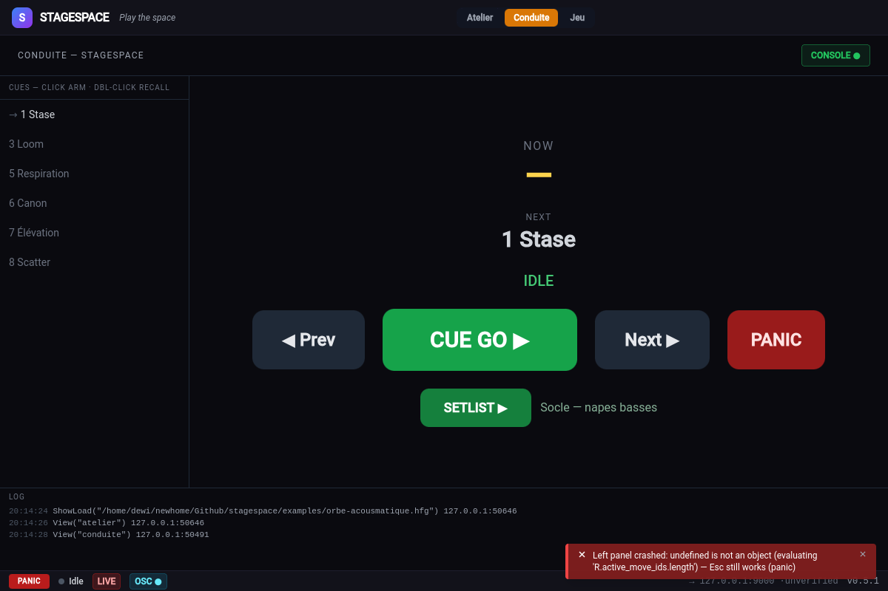
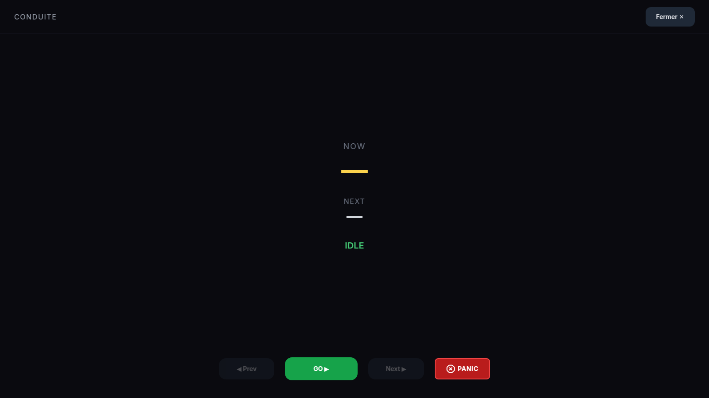
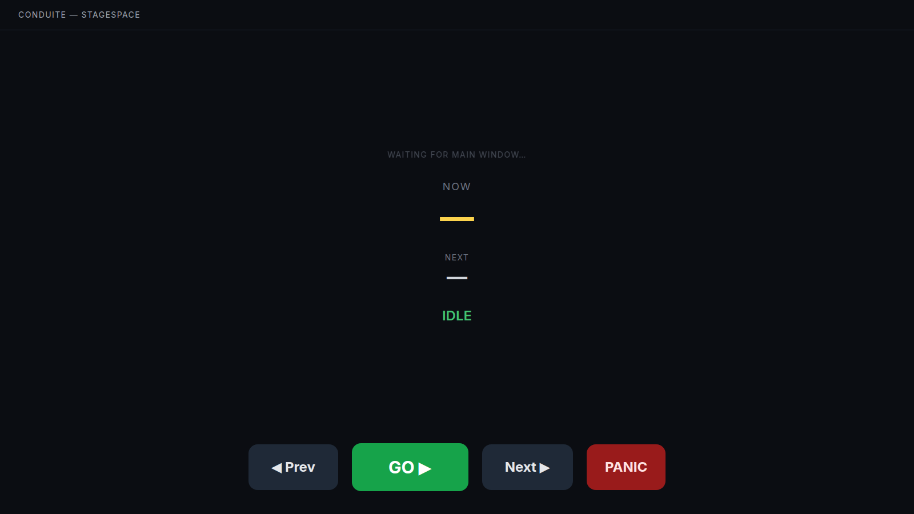
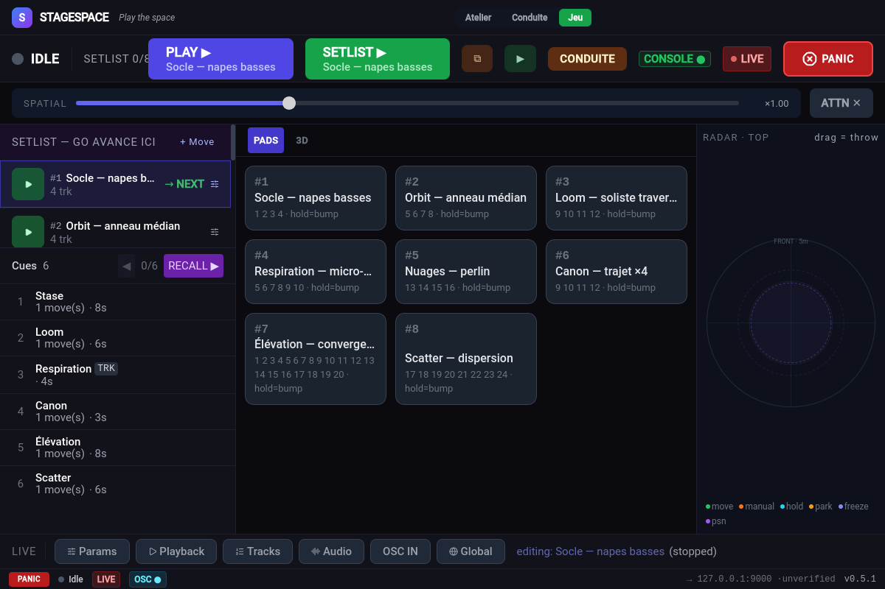
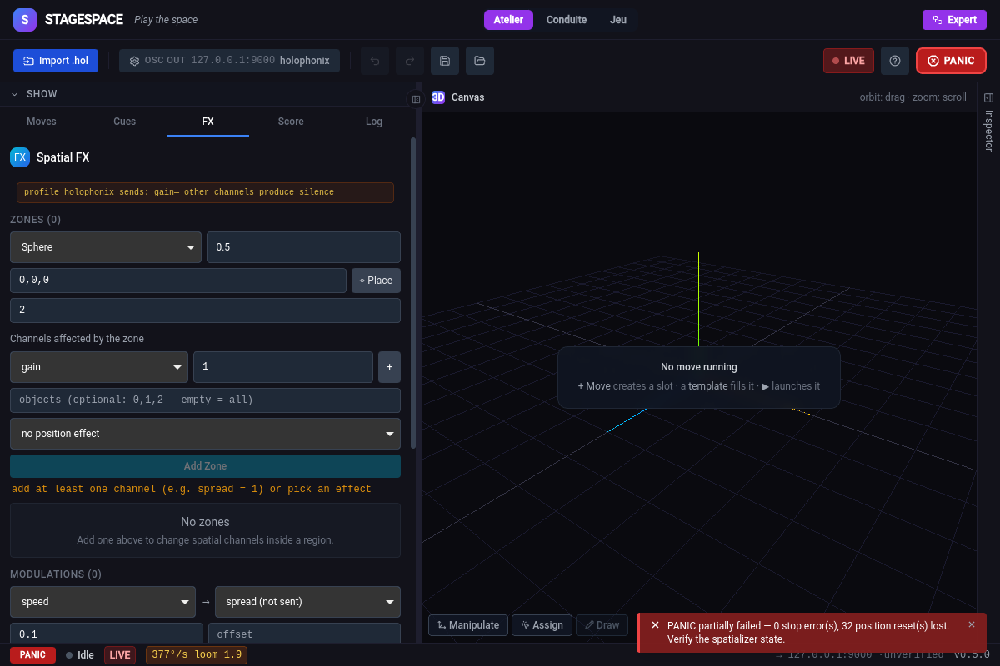

# Manuel utilisateur — STAGESPACE

Moteur de **trajectoires et de position spatiale** : STAGESPACE ne produit pas de
son — il envoie en OSC les positions, canaux et modulations de vos objets audio
vers un renderer externe (Holophonix, SPAT Revolution, IEM, ADM-OSC, ou tout
récepteur OSC).

```
Graphe de nœuds → moteurs f(t) → merge 60fps → OSC → renderer → enceintes
```

---

## 1. Premiers pas

### Welcome

Au premier lancement, STAGESPACE propose de charger le **show d'exemple** ou de
partir de zéro. Le lexique du show est affiché d'emblée — retenez ces 4 mots :

| Mot | Signification |
|-----|---------------|
| **Template** | une forme de trajectoire (Circle, Spiral, Physics…) |
| **Move** | un template + des tracks assignées + des paramètres |
| **Setlist** | vos moves ordonnés — GO avance dedans |
| **Cue** | un snapshot que vous rappellez en live (Shift+Enter) |



### Configuration minimale

1. Importez votre projet **`.hol`** (bouton *Import .hol* dans la toolbar) pour
   peupler les tracks — ou définissez des **OSC ids manuels** dans Settings.
2. Configurez **OSC out** : adresse, port, profil du renderer
   (Holophonix / Spat / IEM / ADM / générique XYZ / générique AED).
3. Les positions partent à **60 fps** dès qu'un move tourne.

---

## 2. Les surfaces

STAGESPACE est organisé en une **vue live de base** (Perform) et deux
**surfaces de focus** plein écran (Busking, Conduite), plus la **fenêtre
conduite détachable**. Le mode **Edit** sert à la préparation.

### 2.1 Perform — la vue live de base



| Zone | Rôle |
|------|------|
| Topbar | PLAY ▶ (slot armé) · GO (setlist) · BUSKING · ⧉ · CONDUITE · LIVE · **PANIC** |
| Colonne gauche | **Setlist** (GO avance ici) + **Layers** (parallèle) + **Cues** |
| Centre | Preview 3D — orbite drag, zoom scroll, boutons *Manipulate* / *Assign* |
| Onglets bas | Params · Playback · Tracks · Audio · OSC IN · Global |
| StatusBar | statut · **LIVE/DRY-RUN** · **BACKEND ✕** · perf · erreurs · destination OSC |

- **PLAY ▶** affiche le move armé — tap = lancer, re-tap = stop.
- **GO** avance la setlist en crossfade ; les layers jouent en parallèle.
- La cue list partage la colonne avec la setlist — click = **arm**, double-click
  = **recall** (jamais de recall en un clic).
- **Cue** affichée dans la topbar : `Cue n → suivante armée`.


### 2.2 Edit — la préparation



- **Toolbar** (zonée) : setup (Import .hol, OSC out) · édition (undo/redo,
  save/load show .hfg) · **sécurité live à droite** (LIVE + PANIC).
- **Colonne SHOW** : onglets Moves / Cues / FX — bibliothèque de templates
  (ORBITS, GESTURES, …) en dessous.
- **Canvas 3D** central.
- **Inspector** (droite) : PARAMS, PERFORM (duration/fades/loop), MACROS,
  AUDIO, TRACKS (sélection par patterns : All / None / 1 of 2 / Odd /
  Inverse / 1st half / 2nd half…).

### 2.3 Créer un move


`+ Move` crée un slot — choisissez un **template** (gauche), assignez des
**tracks** (grille numérotée), réglez les **params** et les **fades**
(fade in/out du slot), puis `▶ PLAY · Move n`.

### 2.4 Expert — l'éditeur de graphe



Le toggle **Expert/Simple** ouvre le node editor :

- **Tabs** : `Move graph` (le graphe du slot édité) · `Global FX` (post-traitement
  global) · `Modulation` (graphe signal).
- **Palette** (gauche) : nodes par catégorie — clic pour ajouter,
  **Ctrl+K** quick-add, clic-droit sur un node du canvas = exemples runnables.
- **Canvas** : connexions par drag entre ports — **inputs en haut, outputs
  en bas** (convention Max/MSP). Légende `Ports` en haut à gauche, minimap
  en bas. Un node sélectionné s'édite dans l'Inspector (section NODE).
- **Save** sauvegarde le graphe dans le slot — hot-swap : si le move tourne,
  le nouveau graphe remplace l'ancien en fondu.

### 2.5 Busking — pads plein écran



Bouton **BUSKING** (topbar Perform) : pads géants numérotés `#n`
(= `oscIndex` stable — ne change pas au réordonnancement).

- **Tap** = play/stop · **hold ≥350 ms** = bump momentané (joue tant que tenu)
- **S** = solo (visible quand plusieurs moves jouent)
- Fades propres à chaque slot (configurés en Edit/PERFORM)
- Header : LIVE · PANIC · Fermer — le strict nécessaire en FOH.

### 2.6 Conduite — la vue FOH





Bouton **CONDUITE** : NOW (cue courante, amber), NEXT (armée), *then*,
timers `pre_wait`/`follow`, TC, statut. Le transport **Prev | GO | Next |
PANIC** en bas — `GO` = crossfade setlist, `Prev/Next` = recall cue.

### 2.7 Conduite détachable — le second écran



Bouton **⧉** : la même conduite dans une **fenêtre dédiée** pour un écran FOH
séparé. Si la fenêtre principale ne broadcast pas encore, la page affiche
**« WAITING FOR MAIN WINDOW… »** — pas de page blanche. Chips DRY-RUN /
PARKED / CONSOLE / TC identiques à l'overlay.

---

## 3. Deux façons de travailler

### A. Conduite console — l'ingé pilote depuis sa console

La console émet des commandes OSC `/stagespace/*` ; STAGESPACE chasse.
Le laptop sert au soundcheck et à la surveillance — pas à piloter en live.

```
Snapshot console → OSC → STAGESPACE exécute la cue
                           ↘ feedback → ack/nack + cue courante
```

- **Voyant CONSOLE ●** : vert = dernière commande show-control < 5 s — le lien
  console se voit à l'œil.
- **NACK** : toute commande refusée (`busy`, `not-found`) est renvoyée à
  l'expéditeur — la console sait quand quelque chose n'a pas été exécuté.
- Docs d'intégration : `docs/console-integration.md`.

### B. Busking — concert non-timecodé, à l'inspiration

Les slots se préparent à la balance, se tirent au numéro ou au doigt.

- **Layers** : les moves jouent en parallèle — superposez un essaim sur une orbite.
- **UNSOLO** : rejoue les slots coupés par le dernier solo.
- **STOP ALL** : coupe tous les moves en fondu (moins brutal que PANIC).
- **Expression live** : macros (scale/shift/rotation/speed), positions manuelles,
  faders externes via OSC-IN mappings.

---

## 4. Les cues en détail

- **Full** = remplace tout l'état (moves, canaux, graphes, macros, mappings).
- **Tracking** = merge par index objet — ne touche que ce qui est enregistré
  dans la cue (scope par catégories). Ne stoppe jamais les moves non listés.
- `pre_wait` : attente avant exécution (affichée en compte à rebours).
- `follow` : enchaînement automatique sur la cue suivante.
- `timecode` : la cue se déclenche quand le TC arrive (fps 24/25/30, TC-originated
  skips le pre_wait).
- **Arm** : click simple = arme ; le recall va sur l'armée (ou la suivante).

---

## 5. Gestes spatiaux & expression live

Commandes d'expression directe — utilisables depuis la console ou le busking :

| Message | Effet |
|---------|-------|
| `/stagespace/throw <obj> <vx> <vy> <vz>` | lance l'objet *obj* avec une vélocité (balistique — il dérive et revient) |
| `/stagespace/spatial <k>` | compresseur spatial global : `k<1` resserre le champ, `k>1` l'étend — geste live |
| `/stagespace/attention <obj>` | fige tous les autres objets — un seul bouge (*change blindness*) ; `/attention/clear` libère |
| `/stagespace/gesture <name> [strength]` | geste composé en une commande : `explode` · `converge` · `orbit` · `front` — vélocité calculée par objet |
| `/stagespace/soundcheck [stop]` | sonde cyclique des objets (passe chaque track en revue — vérification des canaux) |
| `/stagespace/rehearsal <action>` | mode répétition & pos-tape — alias `/stagespace/record` (voir ci-dessous) |

**Pos-tape** (`/stagespace/rehearsal <action>`) — enregistrement/rejeu de positions :

- `record` — capture les positions émises @30 Hz (jeu simulé sans acteurs)
- `stop` — arrête la capture
- `play` — rejoue la bande au rythme réel (injectée dans le merge)
- `export` — exporte la bande en `.sstape.json`

## 6. Contrôles interactifs (surfaces)

Au-delà des boutons, plusieurs contrôles directs sur les surfaces :

- **Radar 2D** (vue Jeu — panneau droit) : plan top-down X/Y des positions
  mergées live, colorées par source de contrôle (move/manuel/hold/park/freeze).
  **Drag un objet = grab & throw** — vous lancez physiquement la source.
- **GestureStrip** (vue Jeu) : slider de **compression spatiale** `k`
  (resserre/étend le champ en live) + release de la stase attention —
  partagé avec la fenêtre `?view=run`.
- **LiveDrawer** (bas de PerformView) : panneau à scopes — Params / Tracks /
  Audio du move sélectionné + Global merge — le canvas 3D reste visible
  pendant le tweak (pas de modal).
- **Manipulate / Macros** (overlay canvas) : macros **globales** merge
  (speed, scale, shift, rotation — affecte tous les moves live) +
  *clear overrides* des positions manuelles.
- **ManualReleaseBar** (flottante, toutes surfaces) : un objet dragué est
  **tenu en manuel** (prioritaire au merge, il reste figé) — la barre permet
  de **libérer** chaque retenue d'un geste.
- **ObjectInspectBar** : clic sur un objet (3D ou radar) → inspect — état
  source (manuel/move/hold/park/freeze), position, boutons de release par
  mode. Le détail par objet sans ouvrir l'Inspector.

## 7. Sémantique « continue » d'un move

Deux flags par move/slot (onglet **Playback**) :

- **`End: hold`** — à la fin d'un one-shot, les dernières positions deviennent
  des positions manuelles : l'objet **reste où le move l'a laissé**
  (`revert` par défaut = retour à la position de base).
- **`Anchor: current`** — au lancement, chaque objet capture sa position
  courante comme ancre (`delta = capturée − traj(0)`) : le move part **de là
  où l'objet est**, sans saut — chaînage move→move façon release/peg-out.

Combinés, `hold` fige l'objet au point d'arrivée et `current` fait démarrer
le move suivant depuis ce point — conduite « continue » sans téléportations.

---

## 8. Référence OSC show-control (`/stagespace/*`)

Port entrant = `oscInPort` (défaut 8001). Préfixe réservé — intercepté avant
vos mappings utilisateur.

| Message | Effet |
|---------|-------|
| `/stagespace/go` | GO setlist (= Entrée) |
| `/stagespace/cue/next` · `/prev` | cue suivante / précédente |
| `/stagespace/cue/recall <n> [fade]` | cue par numéro/nom ou index ; `fade` optionnel |
| `/stagespace/slot <n>` · `/slot/stop <n>` · `/solo <n>` | busking : joue / coupe / solo le slot `#n` |
| `/stagespace/unsolo` | restore des slots coupés par le dernier solo |
| `/stagespace/park <i>` · `/unpark <i>` | objet index *i* (0-based) hors recalls |
| `/stagespace/position <i> <x> <y> <z>` | position manuelle de l'objet *i* (reprise opérateur) |
| `/stagespace/position/clear <i>` · `/position/clearall` | retire la position manuelle |
| `/stagespace/trackpos <t> <x> <y> <z>` | position d'origine de la track *t* (où panic renvoie) |
| `/stagespace/macro <name> <v>` | macro merge : speed, scale, shift_x/y/z, yaw/pitch/roll, radius_scale, height_offset |
| `/stagespace/cue/arm <n>` · `/cue/go` | armer une cue sans la tirer · tirer l'armée (modèle console) |
| `/stagespace/positions` | dump positions émises → `/stagespace/pos/state <obj> <x> <y> <z>` (backend-direct) |
| `/stagespace/view <s>` | bascule la surface opérateur : `atelier` · `conduite` · `jeu` |
| `/stagespace/show/load <path>` | charge un `.hfg` — **chemin local à la machine STAGESPACE** (alias `/stagespace/load`) |
| `/stagespace/timecode/chase <0\|1>` · `/timecode/fps <n>` | chase on/off · fps du format string (24/25/30, défaut 25) |
| `/stagespace/spatial` `attention` `throw` `gesture` `soundcheck` `rehearsal` | actions spatiales & répétition |
| `/stagespace/arm` · `/disarm` | envoi OSC / **dry-run** |
| `/stagespace/status` | renvoie cue courante/suivante au demandeur |
| `/stagespace/timecode <s \| "HH:MM:SS:FF">` | timecode → chase |
| `/stagespace/panic` · `/stop` | blackout / stop all |

**Feedback** : `ack` sur commande acceptée ; `nack <reason>` sur rejet ;
`cue/current` + `cue/next` à chaque changement et sur `status`. Les 4 derniers
contrôleurs reçoivent le feedback.

### Raccourcis clavier

`Space` play/stop du slot sélectionné · `Enter` GO setlist · `Shift+Enter`
recall cue suivante · `Backspace` cue précédente · `Esc` **panic** ·
`Ctrl+Z`/`Y` undo/redo · `Ctrl+K` quick-add node · `?` cheatsheet

---

## 9. OSC-IN mappings + Learn

Brancher un fader externe — onglet *OSC IN* (PerformView) :

| Destination | Effet |
|-------------|-------|
| `handler:name` | valeur stockée — lisible par le signal graph |
| `macro:scale` (shift/yaw/speed…) | macro du merge — tous les moves live |
| `channel:gain:3` (gain/spread/distance/presence…) | canal de l'objet 3 |
| `position:2` | position manuelle de l'objet 2 (override) |

- **LEARN** : tapez une destination, cliquez LEARN, bougez le fader —
  l'adresse se remplit seule (timeout 10 s).
- **Valeurs live** affichées à côté de chaque mapping.
- ✎ édite · checkbox `enabled` coupe sans supprimer.

---

## 10. Sécurité live

- **Panic (Esc / PANIC)** : stoppe tous les moves + renvoie les positions origine.
- **Dry-run / ARM** : tout tourne, rien ne part au renderer — l'indicateur
  `LIVE`/`DRY-RUN` est **toujours visible** dans la StatusBar.
- **BACKEND ✕** : une commande backend a échoué silencieusement — le moteur ne
  répond probablement plus. Revient au vert au premier IPC réussi.
- **Park** : un objet repris à la main échappe aux recalls — chip **PARKED**
  (topbar + conduite). `park` survit au panic par design.
- **Confirmations** : toute action destructive (delete slot/template, clear-all
  zones/modulations/channels, remove par-item) passe par une boîte de
  confirmation — fini les deletes en un clic.


- **Guards recall** : pendant un recall, les commandes slot/cue sont rejetées
  (`nack busy`) plutôt qu'intercalées — jamais de mouvement orphelin.

---

## 11. Dépannage

| Symptôme | Cause probable | Vérifier |
|----------|----------------|----------|
| Objet qui ne bouge plus aux recalls | Park oublié | Chip **PARKED** |
| "J'ai appuyé et rien ne s'est passé" | Recall en cours ou slot/cue inexistant | `nack` renvoyé au contrôleur |
| Console ne répond pas | Lien OSC mort | Voyant **CONSOLE ●** gris = >5 s |
| `TC lost` | Pas de `/stagespace/timecode` depuis >1 s | Source TC + `oscInPort` |
| Move qui joue en silence | Tracks hors liste OSC / dry-run | `LIVE` vs `DRY-RUN` + dest OSC StatusBar |
| Tout est figé, rien ne répond | Backend mort | Chip **BACKEND ✕** StatusBar |
| Fenêtre conduite noire | Fenêtre principale fermée / pas de broadcast | « WAITING FOR MAIN WINDOW… » |
| Graphe pas appliqué au live | Hot-swap raté | Pill erreur StatusBar/Toolbar (persiste après le toast) |

---

## 12. Fichiers & persistance

| Quoi | Où |
|------|-----|
| Show complet (graphes, slots, cues, OSC, FX) | fichier `.hfg` — Toolbar save/load ou `/stagespace/show/load <path>` |
| Projet Holophonix | `.hol` (import — source de vérité des tracks) |
| Auto-save du graphe en édition | à chaque changement structurel |
| Slots | localStorage (persistés entre sessions) |
| Préférences UI (legend, collapsed…) | localStorage `stagespace.*` |

---

## 13. Conduite d'exemple

`examples/conduite-epilogue.hfg` (+ `.md`) : spectacle ~1 h 25, 19 cues,
14 moves, deux actes + entracte — TC, follow, tracking, safety cue S1.
Importez-le pour explorer tous les mécanismes.

Quatre conduites scénarisées supplémentaires (`docs/conduites/*.md`) :
`orbe-acousmatique.hfg` (24 tracks, 8 slots, 6 cues) · `grid-dj-spatial.hfg`
(16 tracks, TC chase, busking) · `sillage-theatre.hfg` (tracking cues, PSN) ·
`traverse-multimedia.hfg` (TC maître, canon, finale). Elles se chargent aussi
via `/stagespace/show/load examples/orbe-acousmatique.hfg`.



---

# Appendices

## A. Référence des nœuds

Les nœuds s'ajoutent depuis la palette (ou `Ctrl+K`). **Entrées en haut, sorties
en bas.** Les ports ont un type (Positions, ObjectSet, Duration, Signal…) —
seules les connexions valides sont acceptées.

### A.1 Structurels — l'ossature du graphe

| Nœud | Rôle |
|------|------|
| `Objects` | source : la liste des objets/tracks du move |
| `Duration` | durée du move — nécessaire au play |
| `Output` | sortie : dernier nœud avant le runtime |
| `Group` | regroupe des nodes en sous-ensemble |
| `Mix` | mixe deux flux de positions (ponderation) |
| `Sequence` | chaîne des moves dans le temps |
| `Crossfade` | fondu entre deux entrées |

### A.2 Moteurs math — trajectoires générées

`Circular` · `Elliptical` · `Spiral` · `Lissajous` · `Figure8` · `Linear` ·
`Oscillation` · `PerlinNoise` · `Formation` (formations de groupe :
ligne/arc/grille) · `Converge` (convergence vers un point) · `Pendulum` ·
`RoseCurve` · `Helix` · `Wave` · `CustomTrajectory`

### A.3 Moteurs physique — simulation

`Bouncing` (rebonds) · `Spring` (ressort) · `Follow` (poursuite) · `Swarm`
(essaim/boids) · `Avoidance` (évitement mutuel) · `VectorField` (champ de
vecteurs)

### A.4 Splines — trajectoires dessinées

| Nœud | Rôle |
|------|------|
| `DrawSpline` | contient les points dessinés à la main (draw mode) |
| `EvaluateSpline` | évalue la spline → positions f(t) |
| `TrimSpline` | extrait une portion de la spline |
| `OffsetSpline` | décale la spline dans l'espace |

### A.5 Envelopes (ex-Falloffs) — influence spatiale/temporelle

`TimeFalloff` (enveloppe dans le temps) · `PointDistanceFalloff` (influence
selon la distance à un point) · `DirectionalFalloff` · `AudioAmplitudeFalloff`
· `AudioFalloff` — une envelope module l'influence de n'importe quel paramètre.

### A.6 Modifiers — transformations

`Scale` · `Rotate` · `Offset` · `PhaseShift` · `Mirror` · `Clamp` · `LFO` ·
`Jitter` · `SpeedScale` · `Delay` · `Freeze` · `Switch` · `RadiusScale` ·
`HeightOffset` · `PerTrackDepth` · `Barycenter`

### A.7 Sources — données externes

`BPM` (détection tempo audio IN) · `AudioAmplitude` · `AudioSpectrum` (FFT
par bande) · `OSCInput` (valeur OSC entrante)

### A.8 Global (post-process) — graphe Global FX uniquement

| Nœud | Rôle |
|------|------|
| `Merge` | stratégie de résolution quand plusieurs moves ciblent la même track (override/crossfade/blend/priority — le dernier écrivain gagne) |
| `Zone` | déclare une zone spatiale pour le panel Spatial FX |
| `Velocity` | déclare un canal de modulation vélocité |
| `ManualPosition` | override de position manuelle — lit les drags 3D (positionnement à la main) |

### A.9 Composite & plugins

`MoveRef` (référence un autre move — composition de mouvements) · `Plugin`
(moteur WASM externe packagé `.ssx`)

### A.10 Signal — graphe de modulation (tab *Modulation*)

Le graphe signal produit des **valeurs scalaires f(t)** qui modulent les
paramètres de n'importe quel nœud du graphe de positions — LFO sur le radius,
audio sur le speed, etc.

Sources : `SignalConst` · `SignalTime` · `SignalLfo` · `SignalAudio` ·
`SignalOsc` (handlers OSC-IN) · `SignalRandom` · `SignalCounter`
Traitement : `SignalMath` · `SignalMap` (remappage min/max) · `SignalClamp` ·
`SignalMix` · `SignalSlew` (lissage) · `SignalEnvelope` · `SignalThreshold` ·
`SignalBeat` · `SignalSampleHold` · `SignalMux`
Sortie : `SignalOut` — la sortie nommée devient ciblable depuis un paramètre
de nœud.

Chaîne typique : `SignalLfo → SignalMap → SignalOut(speed)` puis dans le
graphe de positions, le paramètre `speed` d'un moteur se lie à cette sortie.

---

## B. Draw mode — dessiner une trajectoire

1. Ajoutez un nœud dessinable au graphe édité (`DrawSpline`, `EvaluateSpline`
   ou `VectorField` en mode `drawn`) — palette Expert ou preset spline.
2. Le bouton **Draw** du canvas 3D s'active — cliquez-le : le canvas passe en
   saisie de dessin (Manipulate/Assign sont exclus).
3. Dessinez à la souris — les points capturés remplissent `DrawSpline.params.points`.
4. Reliez `DrawSpline → EvaluateSpline → Output` si ce n'est déjà fait.
5. **Exit Draw** (bouton dédié ou `Esc`) quitte le mode.
6. La trajectoire fantôme dessinée disparaît à la sortie — ce que vous voyez
   ensuite est la trajectoire réelle du move.

---

## C. Graphe Global FX

Le graphe *Global FX* (tab du node editor) ne produit pas de trajectoire — il
**post-traite** le merge final de tous les moves :

- `Merge` fixe la stratégie de résolution des tracks contestées.
- `Zone`/`Velocity` **déclarent** les zones et canaux que le panel Spatial FX
  (tab FX, colonne SHOW) affiche et édite.
- Les modulations globales (macros d'ensemble) s'appliquent après merge —
  `macro:scale` d'un fader agit sur tous les moves simultanément.



## D. Spatial FX (tab FX)

Le panneau **FX** (colonne SHOW) édite zones, modulations de canaux et canaux
objet déclarés par le graphe global :

- **Zones** : sphere/box, position + taille, canaux affectés (gain etc.),
  `Place` = placement par clic dans la 3D. `clear all` et chaque `×` passent
  par une confirmation.
- **Modulations** : canaux déclarés par les nœuds `Velocity` du graphe global.
- **Canaux objet** : gain/spread/distance/presence par objet — l'équivalent
  spatial d'un fader par track.

## E. Trackers externes (PSN)

STAGESPACE consomme le protocole **PosiStageNet** (PSN) pour le tracking
d'acteurs/danseurs — les trackers apparaissent comme sources de position
(tracker_map) et peuvent piloter des moves Follow ou des positions d'objets.
Le scénario `sillage-theatre` l'utilise pour suivre les danseurs.

## F. Plugins `.ssx` (moteurs WASM)

Les moteurs externes packagés `.ssx` (WASM) se placent dans le dossier
`plugins` de l'app — ils apparaissent comme nœud `Plugin` dans le graphe
et compilent comme les moteurs natifs. SDK : `plugin-sdk/` + `plugin-examples/`.

## G. Config avancée (backend)

| Commande / setting | Rôle |
|--------------------|------|
| **Venue mapping** (`set_venue_config`) | transform sortante : `enabled` + `scale [x,y,z]` + `offset [x,y,z]` + `yaw` — mappage espace canonique → géométrie de la salle |
| **Distance reality** (`set_distance_reality`) | effets perceptuels selon la distance : exagération, gain_atten, air_loss — `None` = désactivé |
| **Media sync** (`set_media_sync`) | synchronisation média externe (source TC/timecode) |
| **Presets** (`preset_save/load/list/delete`) | configurations nommées sauvegardées — rappel rapide de réglages |
| **Découverte renderer** | `Discover renderers` en Settings — scan OSC out disponibles |

## H. Panneaux de monitoring

- **Score** — partition/timeline des cues et événements du show.
- **Log** — historique des commandes show (GUI + OSC `/stagespace/*` reçues) —
  chaque entrée horodatée. Le voyant **CONSOLE ●** reflète l'activité.
- **Audio** — état de la capture audio (périphérique, niveau, BPM détecté).

## I. Référence Settings

| Section | Contenu |
|---------|---------|
| **OSC output** | host:port du renderer + profil (Holophonix/Spat/IEM/ADM/XYZ/AED) + *Discover renderers* |
| **OSC input** | port de réception des commandes (`oscInPort`, défaut 8001) |
| **Merge** | stratégie par défaut — override · crossfade · blend · priority |
| **Track IDs** | IDs virtuels quand aucun `.hol` n'est chargé (ex. `1,2,3,…` ou plages `1-8,12`) |
| **Audio input** | périphérique d'entrée pour les trajectoires audio-réactives (BPM, amplitude, spectre) |
