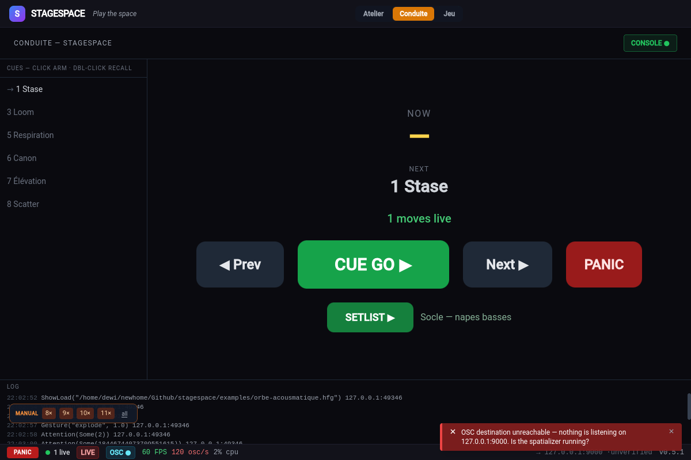
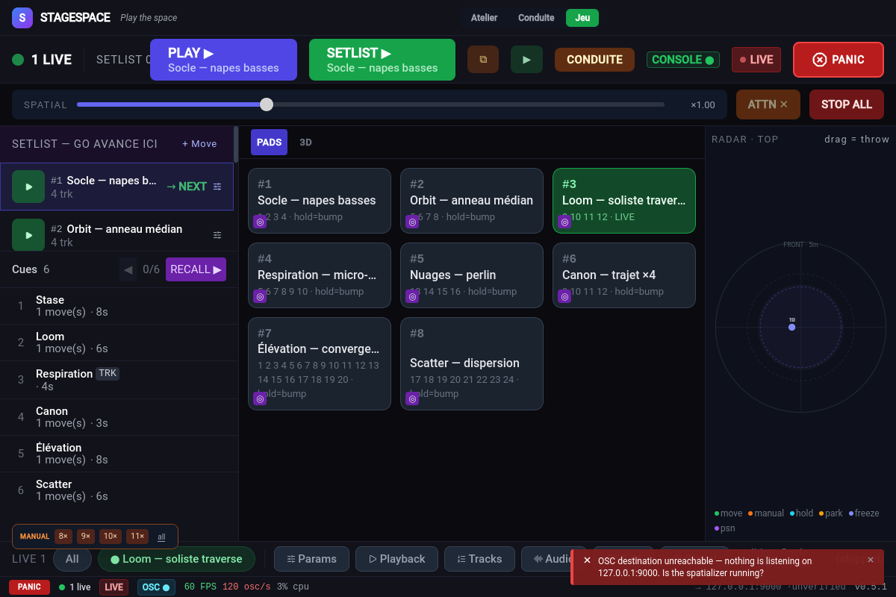
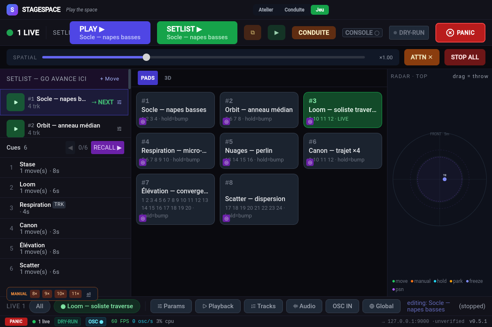

# User manual — STAGESPACE

A **spatial trajectory and position engine**: STAGESPACE produces no
sound — it sends the positions, channels and modulations of your audio
objects over OSC to an external renderer (Holophonix, SPAT Revolution,
IEM, ADM-OSC, or any OSC receiver).

```
Node graph → f(t) engines → 60fps merge → OSC → renderer → speakers
```

---

## 1. Getting started

### Welcome

On first launch, STAGESPACE offers to load the **example show** or to
start from scratch. The show lexicon is displayed right away — remember
these 4 words:

| Term | Meaning |
|-----|---------------|
| **Template** | a trajectory shape (Circle, Spiral, Physics…) |
| **Move** | a template + assigned tracks + parameters |
| **Setlist** | your ordered moves — GO advances through it |
| **Cue** | a snapshot you recall live (Shift+Enter) |


### Minimal setup

1. Import your **`.hol`** project (*Import .hol* button in the toolbar) to
   populate the tracks — or define **manual OSC ids** in Settings.
2. Configure **OSC out**: address, port, renderer profile
   (Holophonix / Spat / IEM / ADM / generic XYZ / generic AED).
3. Positions stream at **60 fps** as soon as a move is playing.

---

## 2. The surfaces

STAGESPACE is organized around a **base live view** (Perform) and two
**full-screen focus surfaces** (Busking, Conduite), plus the
**detachable conduite window**. **Edit** mode is for preparation.

### 2.1 Perform — the base live view


| Zone | Role |
|------|------|
| Topbar | PLAY ▶ (armed slot) · GO (setlist) · BUSKING · ⧉ · CONDUITE · LIVE · **PANIC** |
| Left column | **Setlist** (GO advances here) + **Layers** (parallel) + **Cues** |
| Center | 3D preview — orbit drag, scroll zoom, *Manipulate* / *Assign* buttons |
| Bottom tabs | Params · Playback · Tracks · Audio · OSC IN · Global |
| StatusBar | status · **LIVE/DRY-RUN** · **BACKEND ✕** · perf · errors · OSC destination |

- **PLAY ▶** shows the armed move — tap = launch, tap again = stop.
- **GO** advances the setlist with a crossfade; layers play in parallel.
- The cue list shares the column with the setlist — click = **arm**,
  double-click = **recall** (never a single-click recall).
- **Cue** shown in the topbar: `Cue n → next armed`.


### 2.2 Edit — the preparation


- **Toolbar** (zoned): setup (Import .hol, OSC out) · editing (undo/redo,
  save/load .hfg show) · **live safety on the right** (LIVE + PANIC).
- **SHOW column**: Moves / Cues / FX tabs — template library
  (ORBITS, GESTURES, …) below.
- **3D canvas** in the center.
- **Inspector** (right): PARAMS, PERFORM (duration/fades/loop), MACROS,
  AUDIO, TRACKS (pattern selection: All / None / 1 of 2 / Odd /
  Inverse / 1st half / 2nd half…).

### 2.3 Creating a move


`+ Move` creates a slot — pick a **template** (left), assign **tracks**
(numbered grid), set the **params** and **fades** (slot fade in/out),
then `▶ PLAY · Move n`.

### 2.4 Expert — the graph editor


The **Expert/Simple** toggle opens the node editor:

- **Tabs**: `Move graph` (the edited slot's graph) · `Global FX` (global
  post-processing) · `Modulation` (signal graph).
- **Palette** (left): nodes by category — click to add, or **drag to the
  canvas** (dropped at the cursor; **dropped on a wire = spliced into the
  chain**). **Ctrl+K** quick-add, right-click a node on the canvas =
  runnable examples.
- **Canvas**: drag connections between ports — **inputs on top, outputs
  on the bottom** (Max/MSP convention). `Ports` legend top-left, minimap
  bottom-right. A selected node edits in the Inspector (NODE section).
  **Double-click a node's title = rename the instance** (the name is
  documentary — persisted in the show, ignored by the backend).
- **Wire-drop → quick-add**: dropping a wire on empty canvas opens the
  quick-add **filtered to the wire's port type** — the chosen node is
  placed at the drop point, already wired (plugdata gesture). Works both
  ways (dragged from an output or an input). Exception: pulling a wire
  off an **already-wired input** and dropping it on empty space
  **removes the connection** ("pulling the cable", Max semantics).
- **Autopatch**: three ways to insert `A → M → B` — selected edge +
  palette click, **palette drop onto a wire**, or **double-click a wire**
  (quick-add filtered to both endpoint types, inserted at the click
  point).
- **Reconnect**: dragging an edge endpoint moves it to a new target —
  dropped on empty space, it **removes** the edge.
- **Wire-cutting**: **Alt+drag across wires cuts them** (crosshair
  cursor while Alt is held).
- **Delete-heal**: deleting a mid-chain node (`Delete` or cut)
  **re-heals its neighbours** `A → B` when the port types match —
  plugdata semantics. Nodes with multiple inputs/outputs or incompatible
  types: clean cut.
- **Frames**: the `▭ + Frame` button (palette footer) places an
  **annotation frame** — movable, resizable (handles when selected),
  renamable by double-clicking its title. UI-only: never sent to the
  engine (filtered from every backend payload) but **persisted in the
  show** — the frame survives save/reload.
- **Clipboard**: `Ctrl+C/X/V` copy/cut/paste selected nodes (with their
  internal edges — paste works in another tab), `Ctrl+D` duplicate.
- **Undo/redo**: `Ctrl+Z` / `Ctrl+Y` in **all 3 tabs** — the Global FX
  and Modulation histories merge bursts (a continuous drag = one
  entry), cap 50.
- **Diagnostics**: the errors/warnings badge top-right lists the graph's
  problems — **clicking an issue focuses and selects the offending
  node** on the canvas.
- **Save** stores the graph in the slot — hot-swap: if the move is
  playing, the new graph replaces the old one with a fade.

### 2.5 Jeu — busking pads


The **Jeu** surface is busking: numbered pads `#n`
(= stable `oscIndex` — doesn't change on reordering), setlist on the
left, 2D radar on the right.

- **Tap** = play/stop · **hold ≥350 ms** = momentary bump (plays while held)
- **S** = solo · `/stagespace/slot <n>` · `/solo` · `/unsolo` from the console
- Per-slot fades (configured in Edit/PERFORM)

### 2.6 Conduite — the FOH view



**CONDUITE** button: NOW (current cue, amber), NEXT (armed), *then*,
`pre_wait`/`follow` timers, TC, status. The **Prev | GO | Next |
PANIC** transport at the bottom — `GO` = setlist crossfade, `Prev/Next`
= cue recall.

### 2.7 Detachable conduite — the second screen


**⧉** button: the same conduite in a **dedicated window** for a separate
FOH screen. If the main window isn't broadcasting yet, the page shows
**"WAITING FOR MAIN WINDOW…"** — no blank page. DRY-RUN / PARKED /
CONSOLE / TC chips identical to the overlay.

---

## 3. Two ways of working

### A. Console conduite — the engineer drives from their console

The console emits `/stagespace/*` OSC commands; STAGESPACE follows.
The laptop is for soundcheck and monitoring — not for live driving.

```
Console snapshot → OSC → STAGESPACE executes the cue
                           ↘ feedback → ack/nack + current cue
```

- **CONSOLE ● indicator**: green = last show-control command < 5 s — the
  console link is visible at a glance.
- **NACK**: any refused command (`busy`, `not-found`) is sent back to the
  sender — the console knows when something wasn't executed.
- Integration docs: `docs/console-integration.md`.

### B. Busking — non-timecoded concert, on inspiration

Slots are prepared at soundcheck, fired by number or by finger.

- **Layers**: moves play in parallel — overlay a swarm on an orbit.
- **UNSOLO**: replays the slots stopped by the last solo.
- **STOP ALL**: stops all moves with a fade (less brutal than PANIC).
- **Live expression**: macros (scale/shift/rotation/speed), manual
  positions, external faders via OSC-IN mappings.

---

## 4. Cues in detail

- **Full** = replaces the whole state (moves, channels, graphs, macros,
  mappings).
- **Tracking** = merges by object index — only touches what's recorded in
  the cue (scope by categories). Never stops unlisted moves.
- `pre_wait`: wait before execution (shown as a countdown).
- `follow`: automatic chaining to the next cue.
- `timecode`: the cue fires when the TC arrives (fps 24/25/30,
  TC-originated skips the pre_wait).
- **Arm**: single click = arm; the recall goes to the armed cue (or the
  next one).

---

## 5. Spatial gestures & live expression

Direct expression commands — usable from the console or busking:

| Message | Effect |
|---------|-------|
| `/stagespace/throw <obj> <vx> <vy> <vz>` | throws object *obj* with a velocity (ballistic — it drifts and comes back) |
| `/stagespace/spatial <k>` | global spatial compressor: `k<1` tightens the field, `k>1` expands it — live gesture |
| `/stagespace/attention <obj>` | freezes all other objects — a single one moves (*change blindness*); `/attention/clear` releases |
| `/stagespace/gesture <name> [strength]` | composed gesture in one command: `explode` · `converge` · `orbit` · `front` — velocity computed per object |
| `/stagespace/soundcheck [stop]` | cyclic object probe (walks through each track — channel check) |
| `/stagespace/rehearsal <action>` | rehearsal & pos-tape mode — alias `/stagespace/record` (see below) |

 

**Pos-tape** (`/stagespace/rehearsal <action>`) — position recording/replay:

- `record` — captures emitted positions @30 Hz (simulated play without actors)
- `stop` — stops the capture
- `play` — replays the tape at real pace (injected into the merge)
- `export` — exports the tape as `.sstape.json`

## 6. Interactive controls (surfaces)

Beyond buttons, several direct controls on the surfaces:

- **2D radar** (Jeu view — right panel): top-down X/Y plan of live merged
  positions, colored by control source (move/manual/hold/park/freeze).
  **Drag an object = grab & throw** — you physically throw the source.
- **GestureStrip** (Jeu view): **spatial compression** slider `k`
  (tighten/expand the field live) + attention-stasis release —
  shared with the `?view=run` window.
- **LiveDrawer** (bottom of PerformView): scoped panels — Params /
  Tracks / Audio of the selected move + Global merge — the 3D canvas
  stays visible while tweaking (no modal).
- **Manipulate / Macros** (canvas overlay): **global** merge macros
  (speed, scale, shift, rotation — affects all live moves) +
  *clear overrides* of manual positions.
- **ManualReleaseBar** (floating, all surfaces): a dragged object is
  **held manually** (merge-priority, it stays frozen) — the bar lets you
  **release** each hold with one gesture.
- **ObjectInspectBar**: clicking an object (3D or radar) → inspect —
  source state (manual/move/hold/park/freeze), position, per-mode
  release buttons. Per-object detail without opening the Inspector.

## 7. "Continuous" move semantics

Two flags per move/slot (**Playback** tab):

- **`End: hold`** — at the end of a one-shot, the last positions become
  manual positions: the object **stays where the move left it**
  (`revert` by default = return to base position).
- **`Anchor: current`** — at launch, each object captures its current
  position as anchor (`delta = captured − traj(0)`): the move starts
  **from where the object is**, no jump — move→move chaining,
  release/peg-out style.

Combined, `hold` freezes the object at the arrival point and `current`
starts the next move from that point — "continuous" conduite without
teleportations.

---

## 8. OSC show-control reference (`/stagespace/*`)

Incoming port = `oscInPort` (default 8001). Reserved prefix — intercepted
before your user mappings.

| Message | Effect |
|---------|-------|
| `/stagespace/go` | setlist GO (= Enter) |
| `/stagespace/cue/next` · `/prev` | next / previous cue |
| `/stagespace/cue/recall <n> [fade]` | cue by number/name or index; optional `fade` |
| `/stagespace/slot <n>` · `/slot/stop <n>` · `/solo <n>` | busking: play / stop / solo slot `#n` |
| `/stagespace/unsolo` | restore slots stopped by the last solo |
| `/stagespace/park <i>` · `/unpark <i>` | object index *i* (0-based) out of recalls |
| `/stagespace/position <i> <x> <y> <z>` | manual position of object *i* (operator takeover) |
| `/stagespace/position/clear <i>` · `/position/clearall` | removes the manual position |
| `/stagespace/trackpos <t> <x> <y> <z>` | origin position of track *t* (where panic returns it) |
| `/stagespace/macro <name> <v>` | merge macro: speed, scale, shift_x/y/z, yaw/pitch/roll, radius_scale, height_offset |
| `/stagespace/cue/arm <n>` · `/cue/go` | arm a cue without firing it · fire the armed one (console model) |
| `/stagespace/positions` | dump emitted positions → `/stagespace/pos/state <obj> <x> <y> <z>` (backend-direct) |
| `/stagespace/view <s>` | switch the operator surface: `atelier` · `conduite` · `jeu` |
| `/stagespace/show/load <path>` | load a `.hfg` — **path local to the STAGESPACE machine** (alias `/stagespace/load`) |
| `/stagespace/timecode/chase <0\|1>` · `/timecode/fps <n>` | chase on/off · fps of the string format (24/25/30, default 25) |
| `/stagespace/spatial` `attention` `throw` `gesture` `soundcheck` `rehearsal` | spatial & rehearsal actions |
| `/stagespace/arm` · `/disarm` | OSC output / **dry-run** |
| `/stagespace/status` | re-send current/next cue to the requester |
| `/stagespace/timecode <s \| "HH:MM:SS:FF">` | timecode → chase |
| `/stagespace/panic` · `/stop` | blackout / stop all |

**Feedback**: `ack` on accepted command; `nack <reason>` on rejection;
`cue/current` + `cue/next` on every change and on `status`. The 4 most
recent controllers receive feedback.

### Keyboard shortcuts

`Space` play/stop selected slot · `Enter` setlist GO · `Shift+Enter`
recall next cue · `Backspace` previous cue · `Esc` **panic** ·
`Ctrl+Z`/`Y` undo/redo · `Ctrl+K` quick-add node · `Ctrl+C/X/V/D` node clipboard · `?` cheatsheet

---

## 9. OSC-IN mappings + Learn

Wiring an external fader — *OSC IN* tab (PerformView):

| Destination | Effect |
|-------------|-------|
| `handler:name` | stored value — readable from the signal graph |
| `macro:scale` (shift/yaw/speed…) | merge macro — all live moves |
| `channel:gain:3` (gain/spread/distance/presence…) | channel of object 3 |
| `position:2` | manual position of object 2 (override) |

- **LEARN**: type a destination, click LEARN, move the fader —
  the address fills itself in (10 s timeout).
- **Live values** shown next to each mapping.
- ✎ edits · `enabled` checkbox disables without deleting.

---

## 10. Live safety

- **Panic (Esc / PANIC)**: stops all moves + sends back origin positions.
- **Dry-run / ARM**: everything runs, nothing goes out to the renderer —
  the `LIVE`/`DRY-RUN` indicator is **always visible** in the StatusBar.


- **BACKEND ✕**: a backend command failed silently — the engine is
  probably unresponsive. Returns to green on the first successful IPC.
- **Park**: a hand-held object escapes recalls — **PARKED** chip
  (topbar + conduite). `park` survives panic by design.
- **Confirmations**: every destructive action (delete slot/template,
  clear-all zones/modulations/channels, per-item remove) goes through a
  confirmation box — no more single-click deletes.


- **Recall guards**: during a recall, slot/cue commands are rejected
  (`nack busy`) rather than interleaved — never an orphaned movement.

---

## 11. Troubleshooting

| Symptom | Likely cause | Check |
|----------|----------------|----------|
| Object no longer moves on recalls | Forgotten park | **PARKED** chip |
| "I pressed and nothing happened" | Recall in progress or missing slot/cue | `nack` sent back to the controller |
| Console unresponsive | Dead OSC link | **CONSOLE ●** indicator gray = >5 s |
| `TC lost` | No `/stagespace/timecode` for >1 s | TC source + `oscInPort` |
| Move playing in silence | Tracks outside OSC list / dry-run | `LIVE` vs `DRY-RUN` + OSC destination in StatusBar |
| Everything frozen, unresponsive | Dead backend | **BACKEND ✕** chip in StatusBar |
| Black conduite window | Main window closed / not broadcasting | "WAITING FOR MAIN WINDOW…" |
| Graph not applied to live | Failed hot-swap | Error pill in StatusBar/Toolbar (persists after the toast) |

---

## 12. Files & persistence

| What | Where |
|------|-----|
| Full show (graphs, slots, cues, OSC, FX) | `.hfg` file — Toolbar save/load or `/stagespace/show/load <path>` |
| Holophonix project | `.hol` (import — source of truth for tracks) |
| Graph auto-save while editing | on every structural change |
| Slots | localStorage (persisted between sessions) |
| UI preferences (legend, collapsed…) | localStorage `stagespace.*` |

---

## 13. Example conduite

`examples/conduite-epilogue.hfg` (+ `.md`): ~1 h 25 show, 19 cues,
14 moves, two acts + intermission — TC, follow, tracking, safety cue S1.
Import it to explore every mechanism.

Four additional scripted conduites (`docs/conduites/*.md`):
`orbe-acousmatique.hfg` (24 tracks, 8 slots, 6 cues) · `grid-dj-spatial.hfg`
(16 tracks, TC chase, busking) · `sillage-theatre.hfg` (tracking cues, PSN) ·
`traverse-multimedia.hfg` (master TC, canon, finale). They also load via
`/stagespace/show/load examples/orbe-acousmatique.hfg`.


---

# Appendices

## A. Node reference

Nodes are added from the palette (or `Ctrl+K`). **Inputs on top, outputs
on the bottom.** Ports are typed (Positions, ObjectSet, Duration,
Signal…) — only valid connections are accepted.

### A.1 Structural — the graph's backbone

| Node | Role |
|------|------|
| `Objects` | source: the move's object/track list |
| `Duration` | move duration — required to play |
| `Output` | output: last node before the runtime |
| `Group` | groups nodes into a subset |
| `Mix` | mixes two position streams (weighting) |
| `Sequence` | chains moves over time |
| `Crossfade` | blend between two inputs |

### A.2 Math engines — generated trajectories

`Circular` · `Elliptical` · `Spiral` · `Lissajous` · `Figure8` · `Linear` ·
`Oscillation` · `PerlinNoise` · `Formation` (group formations:
line/arc/grid) · `Converge` (convergence toward a point) · `Pendulum` ·
`RoseCurve` · `Helix` · `Wave` · `CustomTrajectory`

### A.3 Physics engines — simulation

`Bouncing` (bounces) · `Spring` (spring) · `Follow` (pursuit) · `Swarm`
(flock/boids) · `Avoidance` (mutual avoidance) · `VectorField` (vector
field)

### A.4 Splines — drawn trajectories

| Node | Role |
|------|------|
| `DrawSpline` | holds the hand-drawn points (draw mode) |
| `EvaluateSpline` | evaluates the spline → f(t) positions |
| `TrimSpline` | extracts a portion of the spline |
| `OffsetSpline` | offsets the spline in space |

### A.5 Envelopes (ex-Falloffs) — spatial/temporal influence

`TimeFalloff` (envelope over time) · `PointDistanceFalloff` (influence by
distance to a point) · `DirectionalFalloff` · `AudioAmplitudeFalloff`
· `AudioFalloff` — an envelope modulates the influence of any parameter.

### A.6 Modifiers — transformations

`Scale` · `Rotate` · `Offset` · `PhaseShift` · `Mirror` · `Clamp` · `LFO` ·
`Jitter` · `SpeedScale` · `Delay` · `Freeze` · `Switch` · `RadiusScale` ·
`HeightOffset` · `PerTrackDepth` · `Barycenter`

### A.7 Sources — external data

`BPM` (audio-IN tempo detection) · `AudioAmplitude` · `AudioSpectrum`
(per-band FFT) · `OSCInput` (incoming OSC value)

### A.8 Global (post-process) — Global FX graph only

| Node | Role |
|------|------|
| `Merge` | resolution strategy when several moves target the same track (override/crossfade/blend/priority — last writer wins) |
| `Zone` | declares a spatial zone for the Spatial FX panel |
| `Velocity` | declares a velocity modulation channel |
| `ManualPosition` | manual position override — reads 3D drags (hand positioning) |

### A.9 Composite & plugins

`MoveRef` (references another move — movement composition) · `Plugin`
(external WASM engine packaged as `.ssx`)

### A.10 Signal — modulation graph (*Modulation* tab)

The signal graph produces **scalar f(t) values** that modulate the
parameters of any node in the position graph — LFO on the radius, audio
on the speed, etc.

Sources: `SignalConst` · `SignalTime` · `SignalLfo` · `SignalAudio` ·
`SignalOsc` (OSC-IN handlers) · `SignalRandom` · `SignalCounter`
Processing: `SignalMath` · `SignalMap` (min/max remapping) · `SignalClamp` ·
`SignalMix` · `SignalSlew` (smoothing) · `SignalEnvelope` · `SignalThreshold` ·
`SignalBeat` · `SignalSampleHold` · `SignalMux`
Output: `SignalOut` — the named output becomes targetable from a node
parameter.

Typical chain: `SignalLfo → SignalMap → SignalOut(speed)` then in the
position graph, an engine's `speed` parameter binds to that output.

---

## B. Draw mode — drawing a trajectory

1. Add a drawable node to the edited graph (`DrawSpline`,
   `EvaluateSpline` or `VectorField` in `drawn` mode) — Expert palette or
   spline preset.
2. The canvas 3D's **Draw** button activates — click it: the canvas
   enters drawing input (Manipulate/Assign are excluded).
3. Draw with the mouse — captured points fill `DrawSpline.params.points`.
4. Wire `DrawSpline → EvaluateSpline → Output` if not already done.
5. **Exit Draw** (dedicated button or `Esc`) leaves the mode.
6. The drawn ghost trajectory disappears on exit — what you see next is
   the move's real trajectory.

---

## C. Global FX graph

The *Global FX* graph (node editor tab) produces no trajectory — it
**post-processes** the final merge of all moves:

- `Merge` sets the resolution strategy for contested tracks.
- `Zone` injects *designed* zones into the spatial engine (`graph_zones`,
  evaluated before the panel FX's drawn zones — see appendix D).
- `Velocity` declares the kinematic modulations (speed/accel→channel)
  listed by the FX panel.
- Global modulations (ensemble macros) apply after the merge —
  a fader's `macro:scale` acts on all moves simultaneously.


## D. Spatial FX — end-to-end workflow

Spatial effects share the same evaluation engine (per-zone SDF
influence, channel fusion) but have **two creation paths** —
declarative in the graph, interactive in the viewer:

### D.1 Two zone sources, one engine

| | `Zone` node (Global FX) | Drawn zones (FX panel + 3D) |
|---|---|---|
| Creation | Node editor, **Global FX** tab | **FX** panel (SHOW column): `Add Zone` or `Place` → click in 3D; then drag = move, scroll = resize |
| Parameters | `shape` sphere/box, center/radius or min/max, `falloff`, `channels`, `objects`, `enabled` | same + **positional effects** (`repel`, `attract`, `dampen`, `vortex`) — move the objects, exclusive to drawn zones |
| Evaluation | `graph_zones` — replaced wholesale on each graph push, evaluated **before** drawn zones | `zones` — persistent until deleted, evaluated after |
| Persistence | `globalGraph` in the `.hfg` | `zones` array in the `.hfg` |

**Rule of thumb**: the `Zone` node for *designed* effects (reproducible,
versioned in the show) — drawn zones for *live sculpting* in rehearsal
(and the positional effects the node lacks). Both add up in the runtime
merge.

### D.2 The FX panel (SHOW column)

- **Zones**: the form has two modes, always indicated — `+ New zone`
  (creation) or `✎ Editing zone n` (modification, `Update zone n` button,
  `✕ new zone` to exit). `✎` on a zone row loads its parameters into the
  form — the position fields follow that zone's 3D moves while editing;
  `⌖` re-places the center in 3D; `Edit zones` = direct 3D move/resize.
  `clear all` and every `×` go through a confirmation.
- **Modulations**: kinematics — `speed`/`accel`/`jerk`/`angvel` →
  channel. **Declared by the global graph's `Velocity` nodes** (editing
  in the node editor, Global FX tab); the panel lists them read-only.
- **Object channels**: gain/spread/distance/presence per object — the
  spatial equivalent of a fader per track.
- **Readback**: the effective channels shown = static ⊕ modulated ⊕
  zones — the real combined effect of the three sources is visible live.

## E. External trackers (PSN)

STAGESPACE consumes the **PosiStageNet** (PSN) protocol for actor/dancer
tracking — trackers appear as position sources (tracker_map) and can
drive Follow moves or object positions. The `sillage-theatre` scenario
uses it to follow the dancers.

## F. `.ssx` plugins (WASM engines)

External engines packaged `.ssx` (WASM) go in the app's `plugins` folder —
they appear as a `Plugin` node in the graph and compile like native
engines. SDK: `plugin-sdk/` + `plugin-examples/`.

## G. Advanced config (backend)

| Command / setting | Role |
|--------------------|------|
| **Venue mapping** (`set_venue_config`) | outgoing transform: `enabled` + `scale [x,y,z]` + `offset [x,y,z]` + `yaw` — canonical space → venue geometry mapping |
| **Distance reality** (`set_distance_reality`) | perceptual effects by distance: exaggeration, gain_atten, air_loss — `None` = disabled |
| **Media sync** (`set_media_sync`) | external media sync (TC/timecode source) |
| **Presets** (`preset_save/load/list/delete`) | saved named configurations — quick settings recall |
| **Renderer discovery** | `Discover renderers` in Settings — scan available OSC outs |

## H. Monitoring panels

- **Score** — score/timeline of the show's cues and events.
- **Log** — history of show commands (GUI + received OSC `/stagespace/*`) —
  each entry timestamped. The **CONSOLE ●** indicator reflects activity.
- **Audio** — audio capture state (device, level, detected BPM).

## I. Settings reference

| Section | Contents |
|---------|---------|
| **OSC output** | renderer host:port + profile (Holophonix/Spat/IEM/ADM/XYZ/AED) + *Discover renderers* |
| **OSC input** | command receive port (`oscInPort`, default 8001) |
| **Merge** | default strategy — override · crossfade · blend · priority |
| **Track IDs** | virtual IDs when no `.hol` is loaded (e.g. `1,2,3,…` or ranges `1-8,12`) |
| **Audio input** | input device for audio-reactive trajectories (BPM, amplitude, spectrum) |
